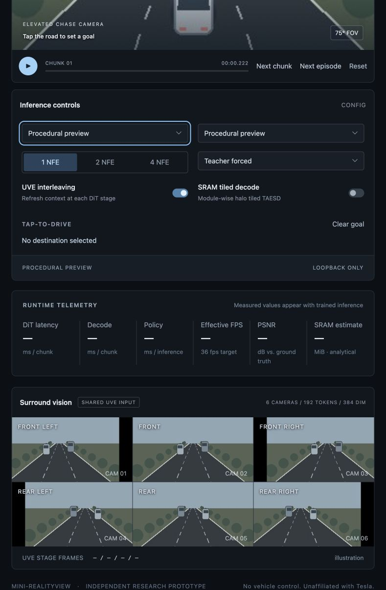
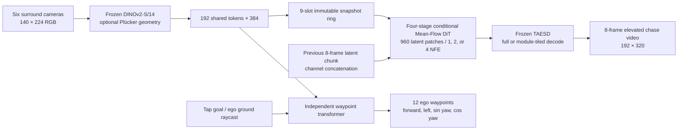

# Mini-RealityView

An independent six-camera **conditional Mean-Flow video generation** prototype
with a shared frozen vision encoder, decoupled waypoint planner, streaming
context, and a local research cockpit. Implements the simulator branch of the
specification in the four supplied reference photographs.

This is research software, unaffiliated with Tesla. It does not reproduce Tesla
weights, establish how proprietary FSD works, or control a vehicle. **36 FPS is a
measurement target, not a guarantee.** See [implementation scope](docs/IMPLEMENTATION.md)
and [verified results](docs/RESULTS.md).



## Quick start

Requires Python 3.11 and [uv](https://docs.astral.sh/uv/). Dependencies are locked.
Use `uv`, never a global `pip install`.

```bash
uv sync --locked --extra dev
uv run --no-sync python -m app.server
```

Open **http://127.0.0.1:8088**. The cockpit initially shows an explicitly labelled
procedural preview. It works without downloads and is not learned generation.
No performance metrics are fabricated. Select a recorded episode for ground
truth; trained predictions require the checkpoint below.

The server binds strictly to `127.0.0.1`, rejects unknown hosts and foreign
origins, bounds and validates requests, and serves only contained image paths.
Do not expose it to the Internet. Model loading uses safetensors, never pickle.

## End-to-end simulator pipeline

Pretrained DINOv2 and TAESD weights download from Hugging Face on first use.
MetaDrive capture requires a working graphics context; Linux NVIDIA EGL is the
tested target for the `p3headlessgl` collector. The rest supports CPU / CUDA / MPS.

```bash
uv sync --locked --extra dev --extra simulator
# Capture 50 train + 4 validation episodes, 180 frames each, at 36 Hz.
uv run --no-sync python collect_metadrive.py --output outputs/dataset
# Full default DiT: 512 width, 12 layers; effective batch size 16.
uv run --no-sync python train_cached_meanflow.py --config configs/train.json
uv run --no-sync python evaluate.py
uv run --no-sync python benchmark_edge.py --checkpoint outputs/train/checkpoint
uv run --no-sync python scripts/verify_artifacts.py outputs
```

For Apple Silicon, use `--config configs/apple.json`. This selects width 384,
8 layers and FP16 autocast with FP32 finite-difference JVP targets. Default CUDA
precision is BF16 when supported; T4 uses FP16 + GradScaler and finite differences.
Training parameters remain FP32. The pretrained visual models remain frozen.

For a smaller integration run, use collector `--train-episodes 2 --val-episodes 1
--frames 80` and trainer `--steps 10 --batch-size 1`. This is a smoke test, not a
quality result. Do not compare its metrics to a 3,000-step run.

On hosts without simulator EGL, the explicitly labelled procedural fixture can
verify the full training/serving path. Its camera views and poses are illustrative,
not physical surround-camera or driving data:

```bash
uv run --no-sync python prepare_demo_cache.py
uv run --no-sync python train_cached_meanflow.py --config configs/smoke.json \
  --data outputs/procedural_smoke/dataset --output outputs/procedural_smoke/train
uv run --no-sync python evaluate.py --data outputs/procedural_smoke/dataset \
  --checkpoint outputs/procedural_smoke/train/checkpoint \
  --output outputs/procedural_smoke/evaluation --max-items 2
REALITY_DATA=outputs/procedural_smoke/dataset \
REALITY_CHECKPOINT=outputs/procedural_smoke/train/checkpoint \
uv run --no-sync python -m app.server
```

The checked-in [smoke contact sheet](docs/evidence/procedural_smoke_contact_sheet.png)
shows noise-like predictions after ten steps. It is deliberately retained as
evidence of the current limits. Full learned visual quality needs the blocked
simulator training run; see [results](docs/RESULTS.md).

## Vast execution

The checked-in `.vast/profile.toml` automatically selects repository settings.
It deliberately inherits the global pricing and reliability safeguards.

```bash
vast-run run --project-root . \
  --remote-setup-command-file scripts/gpu_setup.sh \
  --command-file scripts/gpu_job.sh
```

One runner job performs CUDA matmul and autocast/backward preflight, all tests
including real pretrained models, collection, 3,000-step training, held-out
evaluation, rollout and benchmarking. The workload is capped at 90 minutes.
The runner retrieves `outputs/` and automatically destroys the paid instance.
Its terminal result gives the exact local `outputs_dir`; copy its contained
`outputs` directory into this checkout to use the cockpit. Keep infrastructure
failure separate from workload failure and from a valid poor research result.

## Architecture



- **MiniUVE:** frozen DINOv2-S/14, adaptive 4×8 pooling per camera. Exact manual
  pooling supports MPS's nondivisible 10→4 case. Optional camera-ray embeddings
  use a deterministic frozen projection so caches remain valid throughout training.
- **DiT:** AdaLN-Zero, QK RMS normalization, self/cross SDPA, previous-chunk
  channel concatenation, four context groups with residual age embeddings.
  The token count stays at 960 regardless of the previous chunk.
- **Mean-Flow:** linear noising path, 50% boundary flow matching, detached
  directional target on only `r < t` examples, adaptive inverse-root MSE weighting,
  and previous-chunk noise up to 0.20. Exact JVP runs under math SDPA without a
  higher-order gradient graph; the primal training pass can use fused SDPA.
- **Planner:** independent ~3.3M parameter transformer. Goal FiLM uses meters;
  training supplies jittered true endpoints on 50% of batches and zeros on 50%.
  UI taps change the *planner*, not the video generator or a physical vehicle.
- **Ring:** single writer, multiple nonblocking readers, cloned completed payload
  before reference publication. Scope is CPython threads, not interprocess atomics.
  Each DiT stage can read a newer completed snapshot without blocking on the producer.
- **TAESD:** original latent scale 1 and `[-1,1]` pixels. Retiling between modules
  avoids the insufficient end-to-end receptive-field halo in a naïve halo-8 decoder.
  The SRAM estimate assumes INT8 weights and three FP16 feature buffers under a
  fused schedule. Execution is floating point; PyTorch intermediates remain in DRAM.

## Data and outputs

```text
outputs/
  dataset/{train,val}/episode_NNNN/
    episode.safetensors          # UVE tokens, chase latents, ego poses, calibration
    metadata.json
    raw_preview.png              # Seven-view RGB capture sanity grid
    raw/{front_left,front,...,chase}/00000.jpg
  train/
    run_config.json
    train_metrics.jsonl
    checkpoint/{model.safetensors,config.json}  # EMA DiT + planner
    eval_000500/                 # Metrics and contact sheets every 500 steps
  evaluation/
    metrics.json                # 1/2/4 NFE, PSNR, pixel L1, waypoint L1
    contact_sheet.png            # Previous | GT | 1-NFE | 2-NFE
    reconstruction.png          # GT | TAESD reconstruction | 4-NFE
    closed_loop_32_frames.gif
    rollout_metrics.json
  benchmark.json
  verification/
```

The held-out split uses distinct simulator seeds. Chunks have four staggered
snapshots with ±1-frame jitter and causal stage ages. Poses are rotated into the
current ego frame. Pixel metrics use raw chase JPEGs rather than reconstructed
latents; JPEG compression is part of the reference. All NFE variants share the
same initial noise per comparison. The final rollout feeds each generated chunk
back into the next, and reports drift rather than asserting zero drift.

Checkpoints store inference/EMA weights and JSON configuration. Optimizer resume
is not implemented. Outputs, datasets, downloaded weights and credentials are
ignored by Git. The real-world LiDAR / Gaussian-teacher branch is not part of the
selected MetaDrive implementation.

## Cockpit

Play/pause, next chunk, next episode, teacher forcing, closed-loop video rollout,
1/2/4 NFE, context interleaving, tiled decoding, ground-truth comparison and road
clicks are supported. Keyboard: **Space** play/pause, **N** next chunk, **R** reset.
Closed-loop playback starts at chunk 1 and must advance sequentially; changing
inference settings resets the session to avoid mixing incompatible latent history.
The image-space raycast assumes the collector's fixed chase camera calibration.

```bash
# Optional alternate cache/checkpoint directories:
REALITY_DATA=/absolute/path/to/dataset \
REALITY_CHECKPOINT=/absolute/path/to/checkpoint \
uv run --no-sync python -m app.server
```

The HUD reports measured inference compute time and PSNR. Effective FPS excludes
image transport, browser rendering and the cached encoder pass. SRAM is an
analytical estimate, not measured chip occupancy. Staged arrivals in cached replay
are explicitly emulated; the standalone ring supports an actual producer thread.
All six camera thumbnails advance with the eight chase frames during playback.

## Verification

```bash
uv run --no-sync pytest -q
RUN_PRETRAINED=1 uv run --no-sync pytest -q -m pretrained
node --check app/static/app.js
```

Tests cover ray geometry, shapes, tile equivalence and SRAM estimates, exact vs.
finite JVP and finite gradients, sampling, planner goal response, 50% dropout,
concurrent ring freshness, ego rotation, safe checkpoint round trips, traversal
and symlink rejection, strict API 422s, local origin/host protections, and honest
preview telemetry. GitHub Actions runs the offline suite on push/PR.

## References and licenses

- [DINOv2-S timm model](https://huggingface.co/timm/vit_small_patch14_dinov2.lvd142m)
- [TAESD](https://huggingface.co/madebyollin/taesd), MIT weights
- [MetaDrive](https://github.com/metadriverse/metadrive), Apache-2.0 simulator
- [PyTorch JVP](https://docs.pytorch.org/docs/stable/generated/torch.func.jvp.html)
- [PyTorch SDPA](https://docs.pytorch.org/docs/stable/generated/torch.nn.functional.scaled_dot_product_attention.html)

Third-party model cards and asset licenses apply separately. The DINOv2 model
card and timm config contain differing license metadata; review the upstream
terms before redistributing weights. This repository distributes original code
under MIT and does not include third-party weights or simulator assets.
