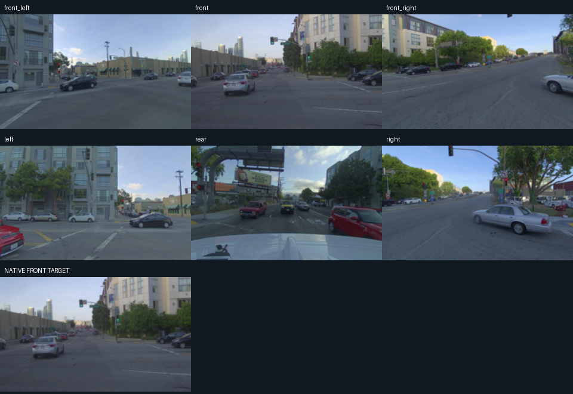
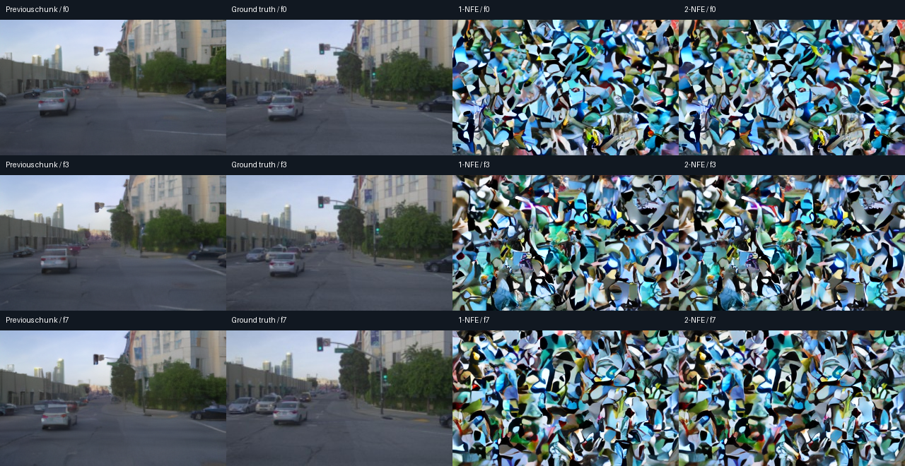

# PandaSet pipeline verification

**The corrected PandaSet camera-only GPU pipeline completed successfully.** This
is a native-front integration baseline, not an elevated novel-view experiment.
Thirty optimizer steps do not produce a useful learned driving visualizer;
predictions remain noise-like. The results below verify the pipeline and record
that limitation rather than claiming model convergence.

Local source checks: **23 passed, 1 pretrained check skipped**. The corrected
remote run passed **all 24 tests**, including downloaded pretrained weights.
Native PandaSet and Waymo format tests use synthetic fixtures and do not establish
successful operation on real Waymo data. The live remote experiment uses real
PandaSet cameras only, with train 002/003, validation 014 and final test 001.

The earlier insufficient-credit failures in `docs/RESULTS.md` are historical; the
user has since refilled GPU credit.

## First CUDA attempt

Run `vast-20261122T234907Z-33087-4bc895`: **WORKLOAD_FAILED**, RTX 3090, Argentina,
$0.207/hour; runner-reported cost estimate $0.0389. The first infrastructure host
timed out loading and the runner's second host booted successfully.

CUDA 12.4 / PyTorch 2.5.1 matmul and autocast/JVP/backward passed. The suite then
reported 22 passed and one failed: actual pretrained TAESD full-vs-tiled error
reached **0.005329**. No PandaSet images were downloaded and no training began.
The runner retrieved preflight/test logs and confirmed **instance_destroyed=true**.

The CUDA decoder now explicitly uses the native convolution reference backend
(cuDNN disabled, TF32 disabled) for its precision-sensitive encode/decode calls, so
different tile shapes cannot silently use lower-precision algorithms while
claiming FP32 equivalence. This conservative backend can be slower; benchmarks
must include that choice. The strict test tolerance is retained. Native bundle
completion timing was also refined and regression-tested locally after the first
snapshot. The changed workload was then verified in the successful run below.

## Successful real-data run

- Runner: **`vast-20261123T001642Z-34182-e2b818`**, execution source `2ce7fae`.
- Classification: **SUCCESS**, exit code 0; **instance_destroyed=true**.
- NVIDIA RTX 3090, BF16 available; Python 3.11.9, PyTorch 2.5.1+cu124, CUDA 12.4.
- Price $0.207/hour; runner-reported cost estimate **$0.0346**. Together with the
  initial failed workload's estimate, reported cost was approximately $0.0735.
- Provisioning: 37 seconds; workload (including selective data fetch): 362 seconds.
- CUDA matmul + exact/finite Mean-Flow autodiff/backward passed; **24 tests passed**.
- Mirror revision: **`e2e123aea3b3132c67f4b395ec6120f63e190271`**.
- **1,608 camera/JSON files, 297.98 MiB extracted**. No full archive, LiDAR or
  annotations were downloaded. Native camera data/caches stayed on remote scratch.
- 64 native frames per scene, ~10Hz, train **002/003**, validation **014**, test **001**.
- The checkpoint contains only train IDs `pandaset/002`, `pandaset/003` and
  validation ID `pandaset/014`; the final test report references only `pandaset/001`.
- Tiny DiT: width 128, depth 4, **1,924,512 parameters**; planner **3,280,036**.
- **30 optimizer steps** completed with finite gradients; 8.03 seconds including
  scheduled validation. Last flow loss 1.1658, policy loss 1.4897, total 2.6555.
  Batch losses vary with scene and are not a convergence result.
- Checkpoint/JSON/JSONL/PNG and 32-frame GIF integrity passed on the GPU and again
  after local retrieval. Returned checkpoint + evidence: **39 MiB**.

### Native-front validation and test

Each metric uses two held-out chunks with the same noise across NFE variants.
Pixel values are in `[-1,1]`; the reference is the re-encoded observed front JPEG.
The front camera is also a conditioning input, so this is not a camera-holdout or
future-only prediction evaluation. Sequence 001 was not used by the trainer.

| Split | NFE | PSNR (dB) | Pixel L1 | Waypoint XY L1 (m) |
|---|---:|---:|---:|---:|
| Validation 014 | 1 | 8.5564 | 0.60975 | 3.3747 |
| Validation 014 | 2 | 8.5566 | 0.60973 | 3.3747 |
| Validation 014 | 4 | 8.5566 | 0.60973 | 3.3747 |
| Test 001 | 1 | 8.8426 | 0.59075 | 8.8268 |
| Test 001 | 2 | 8.8428 | 0.59074 | 8.8268 |
| Test 001 | 4 | 8.8428 | 0.59073 | 8.8268 |

The raw camera grid was visually inspected: views are correctly oriented, colors
are plausible, six distinct cameras are present, and the target is plainly labelled
native front. The prediction contact sheets and autoregressive rollout are still
noise-like. Similar NFE scores at this stage do not show that one step suffices
after meaningful training. Four rollout chunks have latent L1 0.9975, 0.9975,
0.9972 and 1.0052; zero drift is not established.

PandaSet camera imagery: Hesai Technology and Scale AI, CC BY 4.0 per the
[mirror](https://huggingface.co/datasets/georghess/pandaset). Images were resized
and labelled for this report. See [dataset attribution](REAL_DATA.md#attribution).

### Compute benchmark for the small smoke model

Three timed repeats after two warmups, batch 1, eight output frames. DiT sampling
uses BF16; TAESD decode uses FP32 via the conservative native convolution reference
backend with cuDNN disabled. Times include video generation + decoding plus the
separately measured planner median. Encoder capture/encoding, camera publication,
image transport and browser rendering are excluded. These are not measurements
of the full 512x12 model or end-to-end interactive FPS.

| Variant | Total median (ms) | Compute FPS | Peak allocated VRAM (MiB) |
|---|---:|---:|---:|
| 1-NFE full | 44.93 | 178.04 | 224.75 |
| 1-NFE tiled | 122.44 | 65.34 | 132.11 |
| 2-NFE full | 50.16 | 159.48 | 224.75 |
| 2-NFE tiled | 127.65 | 62.67 | 132.11 |

Planner median: **2.11ms**. The benchmark retains the original 36fps/222.2ms
research budget for comparison; recordings themselves are ~10Hz, not 36Hz.
Full-vs-tiled max / mean absolute error: **1.2159e-5 / 3.3931e-7**. Analytical
SRAM estimate: **25.166 MiB**, not measured hardware SRAM. The current CUDA
implementation still allocates full intermediates and workspaces in GPU memory.

### Reproducible evidence

- [Source/split/checkpoint provenance](evidence/pandaset_provenance.json)
- [Validation metrics](evidence/pandaset_validation_metrics.json), [test metrics](evidence/pandaset_test_metrics.json)
- [Training summary](evidence/pandaset_training_summary.json), [rollout drift](evidence/pandaset_test_rollout.json)
- [CUDA benchmark](evidence/pandaset_benchmark.json), [CUDA preflight](evidence/pandaset_cuda_preflight.json)
- [24-test JUnit report](evidence/pandaset_pytest.xml)

Locally retrieved full artifacts and the EMA checkpoint are at
`outputs/pandaset_smoke/` (ignored by Git). The runner retains the full log under
its run directory. The paid instance has been destroyed; scratch datasets were
not retained as a persistent paid resource. No full training run or real Waymo
experiment was launched. The next quality step is a larger PandaSet training
experiment and, for true elevated views, a validated camera-only novel-view teacher.
