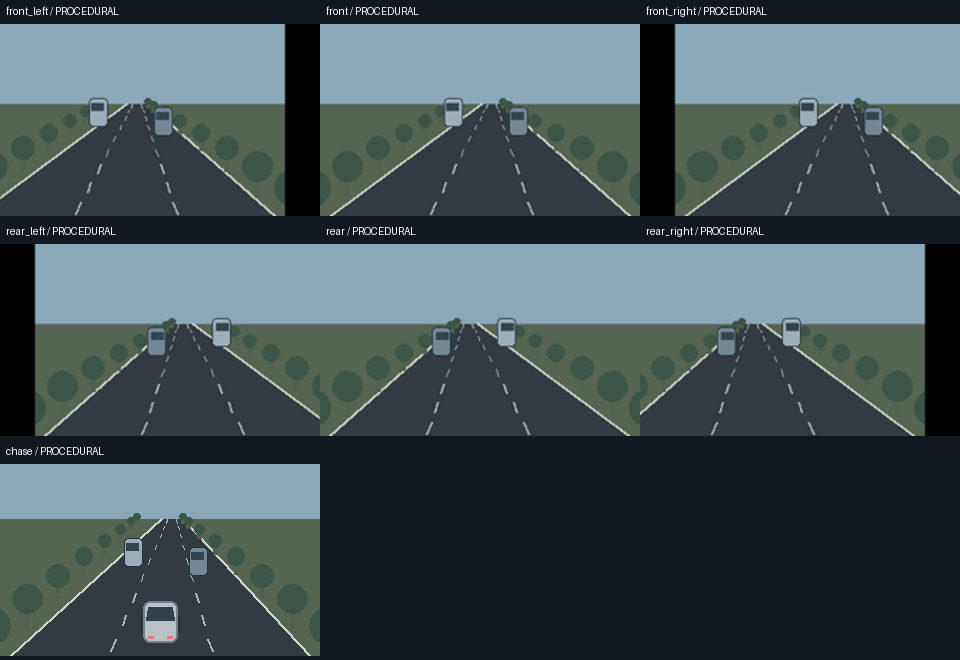
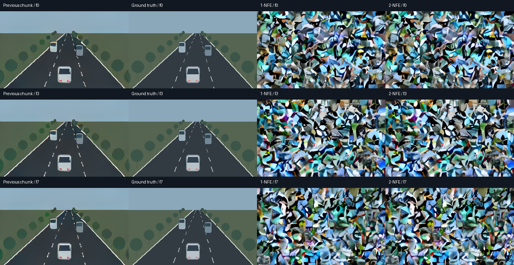

# Verification results — November 22, 2026

**The implementation is tested; the full MetaDrive/CUDA training experiment has
not run.** The available checkpoint is a ten-step procedural integration fixture
and is not a usable learned driving visualizer.

## Local verification

- Python 3.11.13, PyTorch 2.5.1, Apple MPS.
- Offline suite: **16 passed**, pretrained test intentionally skipped.
- Separate downloaded-pretrained check: DINOv2-S/14 and TAESD passed on MPS.
- Real MPS autocast + finite-difference training backward: passed, finite gradients.
- Real FastAPI model/ground-truth integration tests passed, including closed-loop
  sequence validation and independent user session history.
- Live `GET /`, `GET /api/health`, `POST /api/render`: passed at `127.0.0.1:8088`.
  Live rendering used the smoke checkpoint and verified that a road click changes
  learned policy output. Invalid NFE requests return 422.
- Browser checks: layout, next-chunk controls, tap raycast, episode/source changes,
  generated frames, UVE stage IDs and measured telemetry displayed correctly.
- JavaScript syntax, Python compilation, whitespace checks: passed.

The [cockpit screenshot](evidence/cockpit_preview.png) shows the procedural preview,
not a learned prediction. The noise-like learned outputs are shown separately below.

The actual device checks found and fixed three MPS issues: nondivisible adaptive
pooling, unsupported ConvTranspose3d, and NaNs in FP16 SDPA backward. Exact mean
pooling, linear unpatchify, and FP32 MPS attention reductions are used respectively.
CUDA retains standard SDPA selection.

## Procedural integration run

The Linux MetaDrive EGL renderer is unavailable locally. An attempted macOS
capture failed when MetaDrive forced an onscreen graphics window. A separately
labelled **procedural integration fixture** was therefore used to exercise the
whole application pipeline; it is not a replacement for simulator evidence.

- 2 train / 1 validation episodes, each 80 frames.
- Real frozen pretrained DINOv2 and TAESD encoding, safetensors caches.
- Tiny DiT: width 64, depth 4, **622,304 parameters**, full 8×24×40 latent shape.
- Planner: width 288, depth 3, **3,280,036 parameters**.
- 10 optimizer steps, batch 1, EMA 0.995; 24.45 seconds including final evaluation.
- Training loss: 2.8165 at step 1, 1.7465 at step 10.
- Validation (2 chunks): 1-NFE PSNR **9.20 dB**, pixel L1 **0.5708**, waypoint
  XY L1 **2.5233 m** against the analytical fixture poses.
- Four autoregressive chunks (32 frames) rendered successfully. Latent L1 per
  chunk: 1.0207, 1.0181, 1.0199, 1.0176. **Zero drift is not established.**
- All checkpoint tensors, JSON/JSONL, PNGs, and the 32-frame GIF were validated.

Visual inspection confirms the raw fixture has consistent colors and readable
framing. Predicted images remain noise-like at ten steps. This verifies code
execution, not meaningful generation quality. The near-identical 1/2/4-NFE scores
are expected for this undertrained EMA checkpoint and are not evidence that one
step is sufficient for a trained model.

## Measured local edge benchmark

Checkpoint: the **small ten-step fixture above**, not the default 512×12 model.
Three timed repeats after two warmups, batch 1, eight frames. Times include video
generation + decoding + the separately measured policy median. They exclude
encoder capture, HTTP, stage publication/copy costs, and browser rendering.
Live cockpit request timings can therefore be slower, especially on first use.

| Variant | Total median ms | Effective FPS | Headroom vs 222.2 ms |
|---|---:|---:|---:|
| 1-NFE, full | 298.96 | 26.76 | −76.73 ms |
| 1-NFE, tiled | 585.69 | 13.66 | −363.46 ms |
| 2-NFE, full | 583.02 | 13.72 | −360.80 ms |
| 2-NFE, tiled | 611.81 | 13.08 | −389.59 ms |

Independent planner median: **7.05 ms**. Tiled decoding max / mean absolute
difference from full decoding: **1.1742e−5 / 3.0160e−7**. Analytical SRAM estimate:
**25.166 MiB**, comprising 1,222,531 INT8 weight bytes + 24 MiB for three FP16 tile
buffers. This is a software scheduling estimate, not measured physical SRAM.
Actual decoding used FP32; full intermediates remain in DRAM. CUDA peak VRAM
could not be measured. **36 FPS was not achieved in this local benchmark.**

Machine-readable evidence: [training](evidence/procedural_smoke_training.json),
[metrics](evidence/procedural_smoke_metrics.json),
[rollout](evidence/procedural_smoke_rollout.json),
[benchmark](evidence/procedural_smoke_benchmark.json).

## Remote infrastructure blocker

1. `vast-20261122T232131Z-31420-104170`: **INFRASTRUCTURE_FAILED**. No eligible
   RTX 4090 under the inherited $0.350/hour ceiling; cheapest was $0.422/hour.
   No instance was rented.
2. `vast-20261122T232204Z-31439-ee4c24`: **INFRASTRUCTURE_FAILED**. Eligible
   RTX 3090 offers were found at $0.228–0.274/hour, but all three of the runner's
   bounded provisioning attempts returned **account lacks credit**. No instance
   was created, no workload ran, and no paid instance was left by these attempts.

The price safeguard was preserved. No manual lifecycle polling, SSH management,
or retry of a poor scientific result was used. CUDA preflight, full 50+4 episode
capture, 3,000-step full-model training and CUDA benchmarks remain **unverified**.
The prepared `scripts/gpu_job.sh` runs those stages once account credit and an
eligible GPU are available, with automatic output retrieval and destruction.
