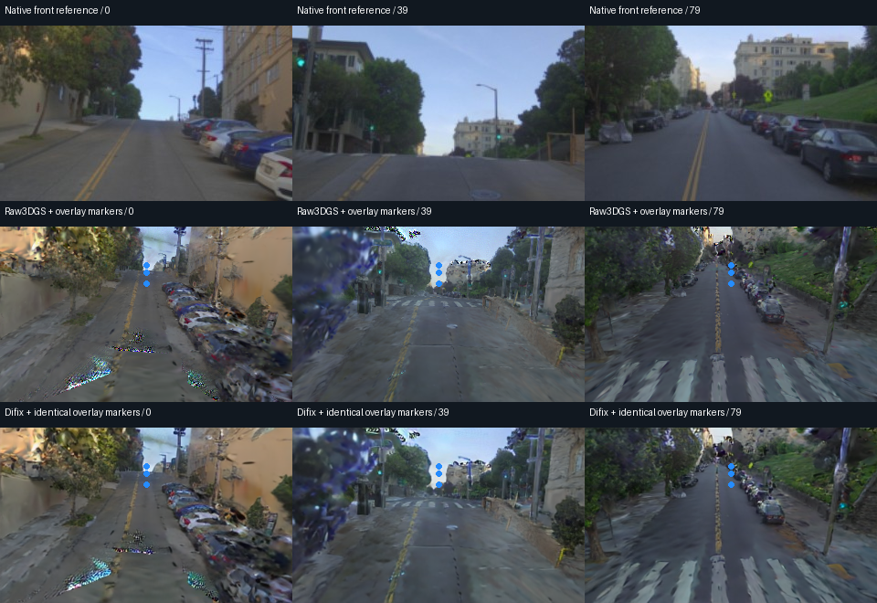

# Scene040: standalone Difix3D replacement completed

**The replacement completed all 80 frames, and its artifacts were retrieved and
verified.** The CUDA execution issue is fixed. Image cleanup did not make the
flying-camera reconstruction acceptable: warped parked cars, floating fragments
and smeared road/building surfaces remain. These images are **not approved as
training targets, for multi-scene batching, or as a finished demo**.

This uses the pinned pretrained Difix3D reference-guided cleanup pipeline
(`nvidia/difix_ref`), not a newly trained model or a new 3D reconstruction.
The existing scene040 raw 3DGS renders and time-matched native-front cached JPEGs
were uploaded; no archive download, refit or additional scene was required.
The references are resized cached camera images from a different viewpoint, not
novel-view ground truth. Model/code revisions and all 80 output hashes are in the
[run receipt](run_receipt.json).

[80-frame cleaned flying-view GIF](chase_difix.gif). The GIF contains the cleaned
RGB sequence; the inspection above supplies the three-row comparison. The blue
dots in the inspection are identical posthoc calibration overlays. They were
never model inputs and their fixed positions do not demonstrate faithful geometry.

## Four requested quality checks

| Check | Finding | Decision |
| --- | --- | --- |
| Color/floaters | Colored fragments and tree/building floaters remain; the threshold color proxies increase | Not accepted |
| Parked-car coherence | Roofs and bodies remain warped/fused, especially early in the sequence | Not accepted |
| Lane/road/building layout | Broad street structure is recognizable, but local surfaces and edges are still distorted; no calibrated novel-view truth | Not approved |
| Temporal stability | No improvement established; measured frame-delta increases, and full frame-by-frame visual review remains pending | Not approved |

Review covers the three inspection frames and clean-GIF samples0,20,40,60,79.
We do not claim an exhaustive temporal visual inspection or that simple image
difference metrics prove geometry/flicker correctness.

| Descriptive metric | Raw | Difix |
| --- | ---: | ---: |
| Cyan fraction, lower band | 0.00045875 | 0.00084125 |
| Purple fraction, lower band | 0.00043969 | 0.00049219 |
| Adjacent-frame RGB L1 | 0.046144 | 0.051456 |

The frame-delta increases about11.5%; this is not motion-compensated or compared
with true elevated-view motion. Mean edit magnitude is0.020119 RGB L1,
edit-residual frame-delta0.023756, and raw/clean lower-band gradient cosine0.842059.
These are descriptive proxies, not novel-view PSNR or proof of correct structure.
Raw reconstruction alpha/coverage and native held-out PSNR are unchanged by this
2D RGB cleanup and are not new Difix quality measurements.

## Execution and transfer

The first attempt failed before inference with CUDA error804. The replacement
used Torch2.5.1 CUDA11.8, removed container forward-compatibility library overrides,
passed GPU matmul preflight and passed the pre-workload artifact-transfer check.
Model, single-step timestep199, guidance0, prompt `remove degradation`, input
frames and seed42 remained pinned. See the [protocol](../../DIFIX_040_PROTOCOL.md)
and [failure/recovery audit](../../PIXART_V2_DIFIX_RECOVERY.md).

| Stage | Seconds |
| --- | ---: |
| Input loading | 0.43 |
| Model loading, including download | 99.27 |
| 80-frame inference | 14.14 |
| Export | 11.53 |
| Total cleanup script | 125.36 |

These are script timings, not total rental time. Estimated rental cost is
**$0.0489**, within the $0.60 cap; it is not a verified provider invoice.
The exact instance was destroyed at2026-11-27T17:31:16Z and absence verified.
Downloaded return: **12.44 MB**, including80clean PNGs, one inspection PNG, one GIF
and small receipts/metrics. All return-file hashes were verified. This public
report includes only the inspection, GIF and compact JSON; it does not duplicate
all80PNGs, raw images, references, model weights or personal runtime metadata.

## Next diagnostic

Work on the [raw scene040 reconstruction](../chase-3dgs-040-smoke/README.md) before
scaling cleanup. Compare held-out native views with progressively elevated views:
if native views fail, check calibration/poses and fitting; if only elevated views
fail, investigate visibility/coverage and dynamic objects. Change one cause at a
time on this scene and require coherent cars/surfaces before generating targets.
Difix can alter appearance but this result supplies no evidence that it repairs
the underlying geometry. No additional rental, batch, Difix training or student
training is launched by publishing this report.

[Metrics](metrics.json), [timings](timings.json), [execution](execution.json),
[review and limits](visual_review.json), [model/input/output receipt](run_receipt.json).
