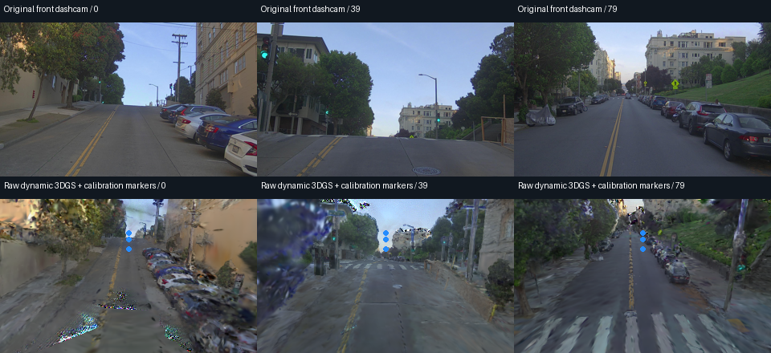

# Prompt B: scene 040 completed; novel-view geometry still fails visual review

**Execution and numerical gates passed. Elevated renders are not yet approved as
training targets.** The managed raw dynamic 3DGS run completed the configured 15,000
iterations, inclusive upstream loop 15,001 updates,exported 80 RGB frames,and completed
core ingestion. No Difix or SMPL was used.

| Check | Result | Threshold |
|---|---:|---:|
| Held-out native-camera PSNR(42images) | 26.3306dB | >=22 |
| Minimum whole-frame alpha | .91527 | >=.50 |
| Minimum lower-band ground alpha | .97998 | >=.85 |
| Minimum ego-footprint alpha | .82617 | reported,not gated |

Native held-out fidelity is not a novel-view ground-truth score. The inspection
still shows floaters,poorly reconstructed tree/wall surfaces,and warped parked
cars. Dense opacity does not prove correct geometry. **No teacher batch,
flying-view generator training or automatic Difix run is authorized by this pass.**
Difix might change appearance but cannot establish missing geometric truth.

[Quality](quality.json),[exact stages](timings.json),[execution/cost](completed_execution.json),
[manual visual review](visual_review.json),[protocol](../../PROMPT_B_PROTOCOL.md).
Build 813.86 s,verified archive download 746.38 s,preprocessing 66.89 s,sky masks 113.37 s,
fit 1658.47 s,render/metrics 68.62 s. Reported rental estimate **0.2892 USD**; instance
absence verified after destruction at2026-11-26T01:20:28Z. No active rental remains.

[Real-data raw flying-view diagnostic GIF](chase_raw.gif). All80RGB targets and
calibration/ingestion artifacts are retained in the compact local return; Git
contains only the report,one inspection and one GIF,not the complete frame set.

## Earlier attempts and lifecycle diagnosis

The native-table retry on source `13083d5` completed all 80 preprocessing frames,
sky-mask generation and Gaussian initialization. The first optimizer backward
call returned, then the diagnostic progress import failed: DriveStudio's `tools`
package shadowed `tools.chase_3dgs`. No successful reconstruction, quality report,
RGB export, GIF or ingestion receipt was returned. This is an engineering failure,
not a negative reconstruction-quality result.

The artifact transfer also failed because a login banner preceded its gzip
stream. Exact per-stage receipts are unavailable; owner-recorded provisioning,
setup and workload times were211s,82s and1379s. Destruction was confirmed at
2026-11-25T23:14:42Z. The owner estimates1.3261 USD rental, **above the intended1 USD
cap**; this is a runner estimate, not an independently reconciled invoice.
[Sanitized execution record](native_retry_execution.json).

The next authorized attempt fixes the import in a non-conflicting runtime
package and hardens wall-clock deadlines, local idle-sleep prevention, binary
artifact transport and transfer timeouts. Local CPU regressions passed, including
an actual conflicting upstream `tools` package. The previous instance was
explicitly verified absent before the new rental. The replacement's results
remain pending; no Difix, batch or styled/flying-view generator training started.

The independent stateless native-front PixArt pilot is described in
[Prompt D](../../PROMPT_D_PROTOCOL.md); it does not consume synthetic flying views.

## Earlier infrastructure attempt

**No usable reconstruction results were retrieved.** The single managed attempt
reached its running phase, then lost its connection beyond the bounded recovery
window. Runner classification: `INFRASTRUCTURE_FAILED`. No workload exit code,
remote log, timing receipts, quality JSON, target images or ingestion receipt was
returned. Reconstruction progress and quality are therefore **unverified**; this
is not evidence of a negative 3DGS result or proof that no reconstruction ran.

Source: `a5f8a92a98ec694859bad7a4b18d2cd65791ec03`.
[Protocol](../../PROMPT_B_PROTOCOL.md), [execution summary](execution.json).

The local fixes were applied before submission: early record-directory rejection,
directory-first minimal artifact collection on EXIT, stage timings and an explicit
ingestion receipt. The full CPU suite passed 124 tests / 1 skipped, with 14 targeted checks
passing afterward. Remote connection loss prevented verification of those stages
in this attempt. No automatic Difix or batch was launched.

## Cleanup and cost reporting

The runner's terminal summary reported approximately **$0.208** at failure, but
omitted a destruction timestamp. Its infrastructure-error branch invokes the
owner's destroy command without recording successful cleanup in metadata.
During this status review, the owner destroy command was reissued successfully
and closure was recorded. The missing timestamp alone does not establish that
the rental continued billing. Do not extrapolate its saved hourly rate to the
review time as an actual provider bill; the final bill has not been independently
verified. The separate $1 owner watchdog was configured as a further safeguard.

No paid retry was started: this was the sole authorized Prompt B attempt. Before
another attempt, improve cleanup/receipt durability and select a reliable host;
local tests or the prior CUDA-build success cannot establish this run's result.
Any new rental requires continuation of the experiment budget/scope.
