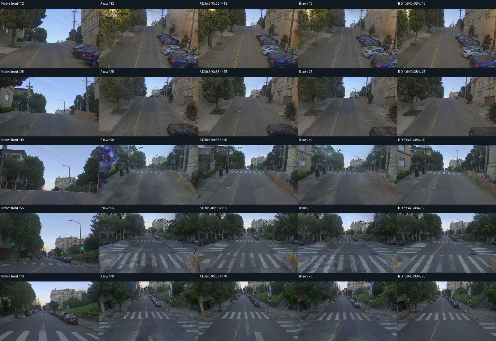

# Scene040 diagnostic refit: completed; poseB cleanup is a promising candidate

Both poses were rendered from one20,000-iteration configured checkpoint, then
processed by pinned reference-guided Difix at640x384. All68frames12–79 completed.
The upstream inclusive loop recorded20,001optimizer updates. No other scene was
fitted and no teacher batch/student/style training was launched.

**Held-out native PSNR:26.4348dB across42views**, passing the requested26dB gate.
The previous raw fit scored26.3306dB; the gain is modest and is not a novel-view
quality score. The five-frame panels show a substantial appearance improvement
from cleanup. PoseB avoids the conspicuous poseA canopy fragment nearframe40.
Cars become more recognizable afterDifix,but generative repairs are not verified
geometry. PoseB+Difix is a candidate for full temporal/human review, not approval
for Prompt3 or a finished sharp teacher.

[68-frame poseB cleaned GIF](chase_poseB_difix.gif).
[Native640x384 paired examples](native_samples/pose_B_difix/00025.png).
The inspection/GIF are320x192previews;Difix received640x384renders and directly
resized full native front JPEGs,not upscaled320x192cache images.

| Measurement | PoseA | PoseB |
| --- | ---: | ---: |
| Minimum raw whole-frame alpha coverage | 91.39% | 89.51% |
| Minimum raw lower-band alpha coverage | 97.64% | 97.70% |
| Minimum raw ego-region alpha coverage | 79.82% | 80.03% |
| Raw frame-delta RGB L1 | 0.041741 | 0.038963 |
| Cleaned frame-delta RGB L1 | 0.044260 | 0.041582 |
| Mean raw/clean pixel L1 | 0.037865 | 0.035118 |

Coverage is thresholded raw opacity after calibration-preserving resize to the
original320x192audit grid. It is not measured surface correctness. Deltas differ
with viewpoint and detail;lower rawdelta is not proof of better temporal geometry.
Cleanup does not demonstrate reduced flicker against the raw sequence.

## Scope and limits

The bundle reduces near_randoms100000→10000, retains far_randoms100000 and800k
LiDAR samples, increases configured fitting iterations15000→20000, discards the
first12frames,and increases cleanup resolution320x192→640x384. It cannot isolate
the cause of improvement. The same-checkpoint A/B comparison isolates the pose
change within this fitted scene, not the full bundle against the old baseline.
Front-reference trajectory travel reaches10.01m byframe12, consistent with avoiding
the pre-start interval;travel distance alone does not prove surface visibility.

Difix at640x384 produced more edits than the earlier320x192run, but those runs
also differ in frame selection/pose/reconstruction. Pixel L1 alone does not prove
a resolution cause or accurate detail. Nativefront references are a different
view;there is no calibrated flying-view ground truth. Five static panels were
reviewed;full frame-by-frame temporal visual review remains pending. See the
[four-check review](visual_review.json). Prompt3 stays on hold.

## Execution and artifacts

Preprocessing67.91s;sky masks114.60s;fit2260.39s(37.67min);native evaluation plus
paired rendering27.03s. Cleanup136images took153.01s including67.50s model load;
inference averaged628.80ms/frame in this FP32 configuration. The archive download
and SHA256 check took513.68s despite the host's lower advertised bandwidth.

The rental lasted about73minutes, cost an estimated **$0.3337**, and was destroyed
at2026-11-27T22:07:01Z with absence verified. Cost is an estimate,not a verified
provider invoice. Returned artifacts total15.72MB;all return-file hashes passed.
The44.5GBarchive and native scene remained remote;no archive,checkpoint,model
weights or build environment was downloaded to this laptop or committed here.
Only critical paired native examples,comparison/GIF,metrics and calibration are
published. Existing raw3DGS/Difix/PixArt reports remain frozen.

[Native quality](native_quality.json),[render/coverage](render_metrics.json),
[cleanup metrics](cleanup_metrics.json),[fit timings](fit_timings.json),
[execution](execution.json),[frozen protocol](../../SCENE040_TWO_DIAGNOSTICS.md),
[explicit projection comparison](../pandaset-explicit3d-040-proof/README.md).

Next: review the entire poseB GIF for coherent cars,lane/road shape and temporal
changes. Do not equate a native PSNR pass or plausible cleanup with correct novel
geometry. No further GPU work is authorized by this report.
