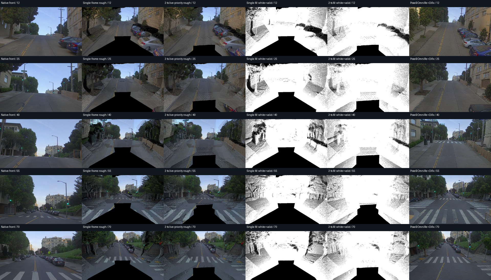

# Scene040 two-timestamp FP16 diagnostic: completed; partial success

Both input-size variants completed all68target frames12–79. **Past-camera
projection approximately halves the hole fraction**, and currently covered
projection pixels remain exactly unchanged. The proposed8–12%holes and25–40ms
depth targets were not reached. Static comparisons still contain a central gap,
sparse/warped edges and seams. **No automatic12-scene export or training starts.**

| Measurement | Input518 | Input392 |
| --- | ---: | ---: |
| Mean whole-frame holes,single timestamp | 30.47% | 30.27% |
| Mean whole-frame holes,t/t−5 | **14.67%** | **15.28%** |
| Mean lower-band holes,single timestamp | 37.02% | 37.53% |
| Mean lower-band holes,t/t−5 | **18.18%** | **19.51%** |
| GPU-resident processing,median | 127.87ms | **72.28ms** |
| GPU-resident FPS from median | 7.82 | **13.84** |
| Frame wall latency including JPEG I/O,median | 283.45ms | 227.44ms |
| FPS including JPEG I/O from median | 3.53 | 4.40 |

Mean paired whole-frame reduction is15.80percentage points at518,and14.99points
at392. Both variants render640x384;518/392are depth-network input sizes,not the
output image width. Their preprocessed tensors are6x3x518x868and6x3x392x658.

[518 comparison](inspection_518.png),[518 raw two-timestamp GIF](explicit3d_2ts_raw.gif),
[392 raw two-timestamp GIF](explicit3d_2ts_raw_392.gif). Each GIF has68frames and
is a320x192preview;the paired projections were generated at640x384.
[Native392 two-timestamp example](samples/392/two_timestamp/00025.png),
[its binary mask](samples/392/two_timestamp_M/00025.png).

## What was tested

Use the same pinned metric Small outdoor model and native six-camera geometry as
the [single-timestamp proof](../pandaset-explicit3d-040-proof/README.md). GPU batched
bicubic RGB resize/ImageNet normalization replaces the CPU image2tensor loop;
the depth forward uses CUDAFP16autocast,while geometry staysfloat32. No LiDAR
scale anchors,Difix inference or previous generated latent enters this run.

Five real camera frames7–11 pre-roll a bounded causal cache. At each targett,
infer its six images once,and reuse real-camera RGB/depth/poses fromt−5. Project
both groups into the same current poseB (back5.5m,height3.0m,pitch17deg,FOV75deg),
then fill only uncovered current pixels from the historical projection. Current
coverage wins even if historical depth is closer. Outside both masks RGBstays
black;M=1means projected coverage,not verified geometry or a semantic road label.

All136target/variant cases have **zero maximum RGB deviation** on current-covered
pixels. This proves the compositing invariant,not zero visual ghosting. Historical
objects can be stale where current coverage is absent;current projections can
already have inconsistent depth/seams. Both full68-frame temporal sequences are
available above;the visual assessment here covers the five requested comparison
frames per variant,not an exhaustive temporal review.

The lower-band proxy is rows134:384 at640x384,equivalent to original67:192 at
320x192. It includes near-ego blind regions and any other objects in that image
band. It must not be interpreted as the fraction of missing drivable road.
The final column contains hash-bound samples from the existing poseB OmniRe+
Difix teacher for comparison only;they are not groundtruth for novel-view accuracy
and are not model inputs to the two-timestamp projector.

## Where the time goes

| Median CUDA-event elapsed | Input518 | Input392 |
| --- | ---: | ---: |
| GPU RGB preprocessing | 0.420ms | 0.317ms |
| Current six-camera depth | 114.43ms | 59.11ms |
| Overlap scale alignment | 8.12ms | 8.01ms |
| Current projection | 2.41ms | 2.42ms |
| Historical projection | 2.34ms | 2.34ms |
| Live-priority composite | 0.075ms | 0.074ms |

Totals in the first table are directly measured start/end elapsed,not sums of
independent medians. Steady state requires one new six-camera depth pass per
frame because past depth is cached. Pre-roll measurements are retained separately.
GPU-resident timing includes host submission/solver gaps but excludes JPEG
loading/resizing,upload,model initialization and diagnostic export. File-I/O wall
latency is reported separately. These are not measured deployed multi-camera
streaming/decoder latencies. JPEG loading alone was roughly155ms/frame here.

Preprocessing is now sub-millisecond,but depth remains the main measured GPU
bottleneck. The historical FP32 baseline's157ms depth/56ms preprocessing came from
another host and CPU preprocessing;this is not an isolated same-host FP16 speed
ablation. Even the faster variant leaves no20–30fps claim for a full refiner+
decode pipeline. No optional slow Difix comparison was run;the already available
teacher samples provide the requested visual reference.

## Execution, transfer and decision

Pinned-weight six-camera FP16 API/numerical/memory checks passed for both sizes
before the archive download,with about1.51GB/0.78GB peak allocation in the synthetic
probe. This probe is not quality evidence. Archive download plus SHA256verification
took608.62s;only scene040 was extracted remotely and its archive scratch deleted.
Native reading in the experiment disables LiDAR inputs. No reserved test scene,
training batch or new model fitting was used.

The rental completed in roughly13minutes at an estimated **$0.0520**,within the
$0.25cap;the estimate is not a verified provider invoice. The exact instance was
destroyed at2026-11-28T02:27:20Z and absence verified. All return-file hashes passed.
Downloaded diagnostics total **21.72MB**,with no model weights,native archive,
checkpoint or environment downloaded to this laptop. This publication retains
compact metrics/calibration,two panels/GIFs and selected native paired rough/mask
samples;it excludes personal rental-access data. Earlier reports remain unchanged.

This is a useful partial result,not an engineering failure requiring an automatic
retry. Hole filling works mechanically;remaining gaps/seams and temporal stale
content need visual judgment. The12-scene export remains gated by that review;
training remains gated by the later12-scene approval. Neither is launched here.

[Full summary](summary.json),[518 per-frame measurements](metrics_518.json),
[392 per-frame measurements](metrics_392.json),[execution](execution.json),
[visual review](visual_review.json),[claim audit](critic_review.json),
[original three-step plan](../../TWO_TIMESTAMP_HYBRID_PLAN.md).
