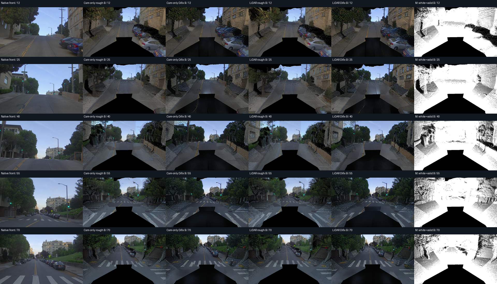

# Scene040 explicit3D proof: completed; coverage and latency remain limiting

**Zero training:** frozen metric Small depth on six cameras, calibrated6DoF
unprojection and nearest-depth z-buffer projection, then pinned Difix at640x384.
All68frames12–79 completed for two poses and two depth sources. Camera-only
alignment uses overlapping-view depth constraints;LiDAR-anchored alignment uses
sparse native metric ratios. They share the same frozen depth predictions.

The projection itself is fast and retains recognizable source texture. It does
not yet provide a complete or real-time flying-camera view. Both variants have
large uncovered regions,stretched surfaces and seams. Difix improves appearance
in populated regions but leaves the large near-field gaps. Those gaps include
the lower-center/near-ego blind region,so whole-frame holes are not a measure of
missing drivable-road pixels alone. No ego-car mesh was added in this diagnostic.

[68-frame camera-only poseB GIF](explicit3d_chase.gif).
[PoseA comparison](inspection_poseA.png).
[Three-angle discrete orbit control](orbit.html) forframe55,or static camera-only
cleaned views at[−25deg](orbit/camera_only_-25_difix.png),[0deg](orbit/camera_only_+00_difix.png),[+25deg](orbit/camera_only_+25_difix.png).
The HTML switches three measured samples;it is not a continuous3Drenderer.

## Coverage and scale

M=1means a valid source-depth projection;hole fraction=1−M.mean(). M is not
confidence that depth is correct. Raw unobserved pixels stay black,with no hole
dilation or geometric completion. Difix receives roughRGB plus a native-front
reference,not M;this is not a validated masked-inpainting model.

| Mean whole-frame holes | CameraA | CameraB | LiDARA | LiDARB |
| --- | ---: | ---: | ---: | ---: |
| 640x384 | 30.46% | 30.46% | 29.44% | 29.60% |
| 512x320 | 26.47% | 26.37% | 26.00% | 25.92% |

LiDAR anchoring reduces poseB's640x384hole fraction by only0.86percentage points.
All408camera/frame anchor sets met the30sample minimum;no scale fallback occurred.
This shows scale anchoring alone does not close the coverage gap. It does not
prove one variant's geometric accuracy,or isolate sensor blind regions from
rasterization/occlusion holes. The512x320projection uses its own calibrated target
intrinsics;do not interpret its lower pixel-hole fraction as new observed geometry.

## Measured latency

| Stage | Milliseconds |
| --- | ---: |
| Frozen depth,all six cameras,median GPU-event elapsed | 156.97 |
| Same depth stage,median wall | 157.00 |
| Camera-only overlap scale alignment,median wall | 6.22 |
| Six-camera poseB640x384projection,median wall | 2.28 |
| Difix,mean wall per image excluding model load | 576.73 |
| Native image loading,median wall | 129.56 |
| Depth preprocessing,median wall | 55.66 |
| Input upload,median wall | 2.68 |

Projection is not the main bottleneck. Difix alone takes overhalf a second,and
six-camera depth takes roughly157ms,so this measured configuration does **not**
meet20–30fps. These stage numbers are not a fused end-to-end stream benchmark;
model loading is excluded and CPU I/O/preprocessing costs are shown separately.
GPU-event elapsed can include host-induced device idle. See all per-frame/pose/
resolution [projection metrics](projection_metrics.json) and [summary](summary.json).

Raw/clean poseB RGB frame-delta is0.043307/0.047934 for camera-only and
0.045514/0.050464 for LiDAR-anchored. Cleanup does not demonstrate temporal
improvement under these proxies;raw smoothness can reward blur and is not true
novel-view motion accuracy. Five static comparison frames and the three orbit
samples were reviewed;exhaustive temporal visual review remains pending.

## Interpretation and next step

Native sensor poses/intrinsics and synchronized depth/LiDAR come from the pinned
dataset;deployment would need equivalent calibration and pose estimates. The
LiDAR variant is a metric reference comparison,not camera-only and not a guaranteed
accuracy upper bound. There is no calibrated flying-camera ground truth or
novel-view PSNR. The near-ego region and background gaps should be measured
separately before choosing a hole-repair method;point-splat discretization,
occlusion boundaries and cross-camera disagreement also need separation.

Keep Prompt3 on hold. First review the cleaner fitted-teacher candidate,then
identify which holes are legitimate ego-footprint occlusions versus missing scene
surfaces. Reduce depth/cleanup runtime in a separate controlled experiment before
claiming a live pipeline. No additional training,render batch or rental is launched.

## Execution and transfer

The archive download/SHA256 check took429.29s. The rental lasted about16minutes,
cost an estimated **$0.0662**,and was destroyed at2026-11-27T21:10:05Z with absence
verified. Cost is not a verified provider invoice. Return-file hashes all passed.
Downloaded diagnostics total38.28MB;no native archive,model weights,training
checkpoint or environment was downloaded locally. This public report keeps only
compact metrics/calibration,two inspection sheets,one GIF,discrete orbit images/
HTML,and selected native-resolution poseB pairs. Existing reports remain frozen.

[Cleanup metrics](cleanup_metrics.json),[execution](execution.json),
[review limits](visual_review.json),[frozen protocol](../../SCENE040_TWO_DIAGNOSTICS.md),
[paired fitted teacher](../chase-3dgs-040-v2-diagnostic/README.md).
