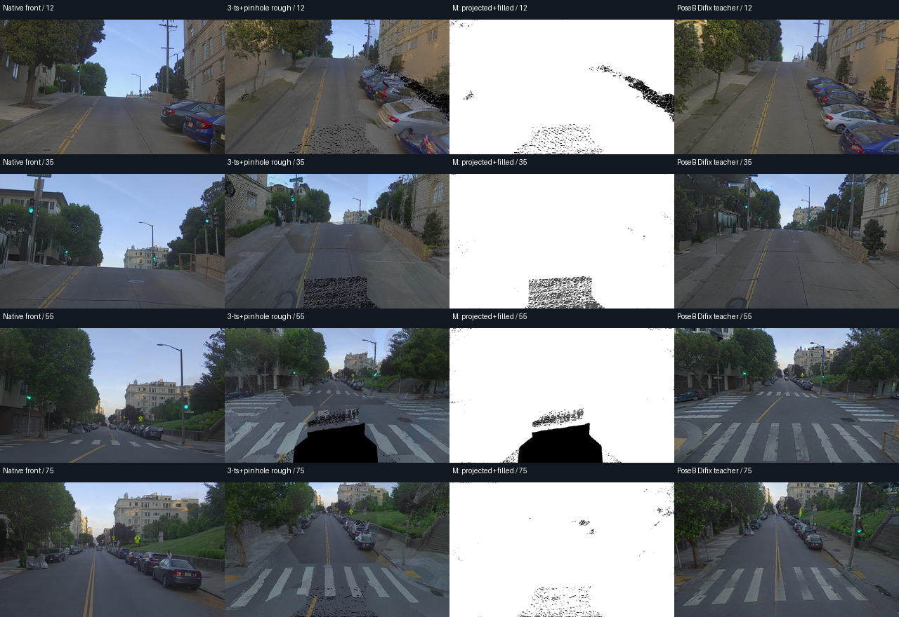
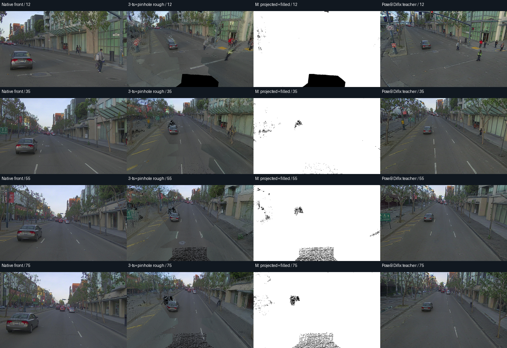
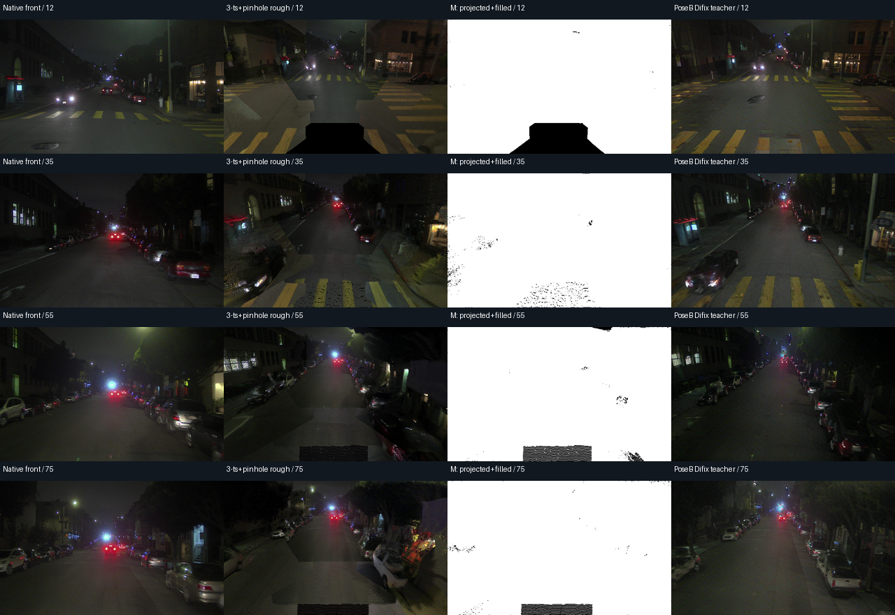
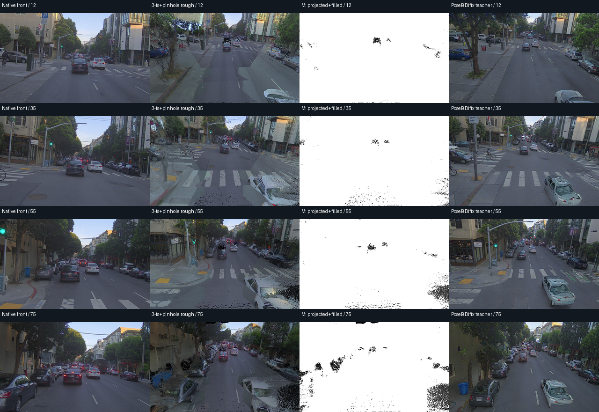

# PandaSet flying teacher / paired explicit3D export

**4/12 scenes exported.** Three resumable four-scene chunks;10train/2val from the existing split. No reserved scene is opened or listed. Training remains gated by visual approval of all scenes.

| Chunk | Scene | Split | Native PSNR | Ground alpha min | Status |
| --- | --- | --- | ---: | ---: | --- |
| 1 | [040](scenes/040/inspection.png) | train | 26.438 | 0.9942 | exported |
| 1 | [006](scenes/006/inspection.png) | train | 24.844 | 0.9980 | exported |
| 1 | [067](scenes/067/inspection.png) | train | 30.124 | 0.9936 | exported |
| 1 | [047](scenes/047/inspection.png) | val | 25.584 | 0.9981 | exported |

PoseB teacher:6cams,800kLiDAR initialization,near_randoms10000,20000configured iterations,held-out native PSNR>=22dB (flag<24),minimum lower-band raw alpha>=0.85. Pinned Difix runs at640x384 with directly resized full native front references. Numerical pass does not establish correct novel geometry.

Student inputs use frozen FP16 metric Small at392,one new six-camera depth pass per source frame,causal t>t-5>t-10 projection,then a single3x3thresholded neighbor fill. M is the post-fill mask;observed_M separately records actual projection coverage. Large-hole interiors remain unfilled;one-pixel eligible boundary changes are possible. Preserving current-covered pixels is not universal moving-object ghost rejection.

Each cache contains both target/rough resolutions512x320and320x192,FP16TAESD latents,packed binary masks,lossless paired RGB for pixel/perceptual-loss evaluation,and full native-source camera256x160TAESD features/calibration/timestamps. Cameras are encoded directly from native JPEGs,not224x140recovery-cache images. Shared letterboxing keeps paired targets,rough and masks aligned.

Only this report,compact receipts and inspection strips are in Git. Compact gzip/safetensors dataset caches stay in local runner returns;native archive,fit checkpoints,models and environments are not downloaded or published. Lossless RGB may make the return larger than the original150–300MB estimate;no lossy compression is used to force that estimate.

Estimated rental cost recorded so far: **$0.9688** of the$6aggregate ceiling,$2maximum per chunk. These are estimates,not provider invoices. Each completed chunk must return verified cache manifests and a verified destroyed instance before another starts.

[Frozen protocol](../../FLYING_EXPORT_STEP2.md) · [Full summary](summary.json) · [Selection](selection.json)

