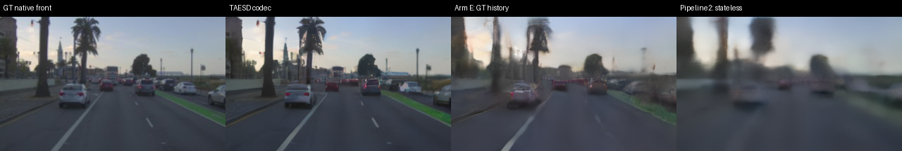

# Prompt D v1: stateless PixArt baseline completed

**All 2,000 updates and eight-scene evaluation completed.** The stateless model
improves numerical accuracy over matched Arm E frames,but cars,poles,trees and
building detail remain visibly smoothed. This is an informative baseline,not a
finished sharp demo. It uses the original v1 recipe at source`de373d0`,not the
subsequently corrected v2 losses/initialization.

| Measurement | Result |
|---|---:|
| Native-front PSNR,all 8 validation scenes,frames 1–79 | 25.1163dB |
| TAESD codec ceiling,same frames | 30.1999dB |
| Matched frames 8–79:PixArt / Arm E | 25.1026 / 21.7958dB |
| Drop-front / swapped-scene PSNR | 17.9469 / 12.7735dB |
| Fixed / fresh noise frame-delta L1 | .015424 / .016705 |
| Fixed / fresh noise GT-motion-residual L1 | .028006 / .028920 |
| Fused model latency | 112.72ms(8.87fps) |
| Model+decode latency | 126.59ms;camera encoding excluded |

Model-only throughput is below10Hz; model+decode is about7.90fps before camera
encoding,so no end-to-end real-time10Hz claim is made.

Matched Arm E receives ground-truth previous 8-frame latents; PixArt uses only
six cameras at t-1 and no latent history. Historical21.88/21.59dB results use
other windows and are not the matched comparison above. Context swapping hurts
quality substantially. The7.17dB drop without the front camera also shows strong
front dependence; this does **not** prove robust cross-camera3D merging.

Fixed noise lowers raw frame-delta L1 by about 7.7%,but motion-residual improvement
is only about 3.2%. Raw temporal smoothness can reward blur. The codec gap is about
5.08 dB; detail remains missing even where layout/colors are numerically better.
The inspection compares GT,codec,Arm E with GT history,and stateless PixArt.

[Fixed-noise real-data diagnostic GIF](rollout_fixed_noise.gif).
[All per-scene metrics](per_scene.json),[evaluation](evaluation.json),
[training curve](training_curve.json),[execution and limitations](execution.json),
[visual review](visual_review.json),[frozen v1 protocol](../../PROMPT_D_PROTOCOL_V1.md).

Training itself took 5257.02 s(87.62min); pre-encoding 133.04 s. The raw summary's
`fit_seconds` includes 162.43 s of post-training/EMA/evaluation work; do not call
that field pure optimizer time. Reported rental estimate **0.5458 USD**,within the
1 USD intended cap. The original local controller exited; the completed existing
job was recovered without resubmission,its artifacts collected,and its exact
instance verified absent after destruction at2026-11-26T02:37:39Z.

Downloaded return:81.6MiB. Retain only one 75.3 MiB EMA adapter,small JSON,eight
inspection PNGs and one GIF. Git contains no model weights,datasets,camera-bank
cache or optimizer state. No 44 GB archive or reserved test data was used here.

## Corrected v2 is prepared,not launched

[The v2 protocol](../../PROMPT_D_PROTOCOL.md) changes robust-loss normalization,
VGG distance/RGB scaling,role initialization,clean-bank sampling and SDPA fallback.
CPU tests passed. These are bundled changes; any future matched comparison cannot
attribute a gain to a single component. V1 weights/results remain preserved.
Per the user's instruction,prepare fixes only: no new GPU job,style training,
Difix or flying-view student training is launched automatically.
