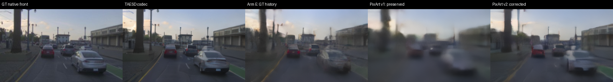

# PixArt v2: native-front pilot completed

**All 2,000 updates and eight-scene evaluation completed.** V2 improves matched
native-front reconstruction over the preserved v1 adapter. Inspection of all eight
static panels shows more recognizable vehicles, road markings and scene structure,
but fine texture, thin objects and night detail remain smoothed or smeared. Blur is
reduced, not solved; these results do not approve style or flying-camera training.

| Measurement, validation frames 1–79 | Preserved v1, reproduced | V2 |
| --- | ---: | ---: |
| PSNR ↑ | 25.1166 dB | **26.2074 dB** |
| V2 perceptual distance ↓ | 0.952010 | **0.730671** |
| Sobel edge L1 ↓ | 0.009258 | **0.009075** |
| Raw frame-delta L1 | 0.015433 | 0.020659 |
| GT-motion-residual L1 ↓ | 0.028013 | 0.028348 |

PSNR improves by **1.0908 dB** and perceptual distance falls **23.25%**. V1 parity
passed: its reproduced PSNR differs from the frozen reference by only 0.00034 dB
(tolerance 0.05 dB). Both adapters were evaluated with the **v2** perceptual metric;
the original v1 report's different VGG metric is not numerically comparable.

On matched frames 8–79, v2 scores **26.1789 dB**, v1 **25.1030 dB**, Arm E
**21.7955 dB**, and the TAESD codec reference **30.2047 dB**. Arm E receives eight
previous ground-truth latent frames; PixArt has no latent-history input. Across
frames 1–79, the codec scores 30.1999 dB, leaving a 3.9925 dB gap for v2.

[One real-data fixed-noise diagnostic GIF](rollout_fixed_noise.gif). It compares
native-front targets, codec, Arm E with GT history, v1 and v2. This is a diagnostic
comparison, not a flying-camera or styled result. All eight static panels:
[014](inspection/pandaset_014.png), [016](inspection/pandaset_016.png),
[047](inspection/pandaset_047.png), [056](inspection/pandaset_056.png),
[071](inspection/pandaset_071.png), [074](inspection/pandaset_074.png),
[093](inspection/pandaset_093.png), [095](inspection/pandaset_095.png).
Full frame-by-frame temporal visual review remains pending.

## What improved and what remains unresolved

The training VGG term decreases from an early five-point mean of **1.261069** to
**0.722244** (42.73% lower). These are different sampled training batches, not a
monotonic curve or a held-out estimate. See the [complete training curve](training_curve.json)
and [loss diagnostics](loss_diagnostics.json).

Temporal consistency did not improve against v1 under the measured proxies:
GT-motion-residual rises about 1.2%. Higher raw frame-delta alone is ambiguous
because blur can make outputs artificially smooth. Fixed noise slightly improves
v2's residual over fresh noise (0.028348 versus 0.028839), but does not establish
stable or accurate motion. Fresh-noise PSNR is 26.2105 dB.

Removing the front camera drops PSNR to **17.7168 dB** (−8.4906 dB); swapping in
another scene's cameras drops it to **12.6371 dB**. The model uses camera context
but remains strongly front-dependent. These probes do not establish robust
cross-camera 3D reconstruction or novel-view generalization.

V2 bundles corrected loss normalization/VGG distance, role initialization,
clean-bank sampling, widened training RGB clamp and target rays transformed by
**observed target-frame planar ego motion** into the previous ego frame. V1 keeps
its original target-local rays. RGB lag, ground-truth targets and evaluation noise
are matched, but conditioning differs. The gain cannot be attributed to one fix;
this is not forecasting with an unknown target pose. See the [v2 protocol](../../PROMPT_D_PROTOCOL.md).

## Runtime, retrieval and scope

Optimizer training took **80.32 minutes**, evaluation 145.80 seconds, and total
script execution 86.08 minutes. On this run's RTX3090, fused model latency was
44.98 ms (22.23 fps), or 47.43 ms including decode. **Camera encoding is excluded**;
this is not an end-to-end real-time claim. Historical v1 latency came from a
different rental and does not demonstrate a controlled speed improvement.

The replacement rental estimate is **$0.4828**, within its $1 cap; this is not a
verified provider invoice. The exact instance was destroyed at
2026-11-27T18:55:21Z and absence verified. Returned artifacts total **87.2 MB**:
one 79.0 MB EMA adapter plus compact metrics, eight PNG panels and one GIF. The
return manifest and all 359 finite checkpoint tensors were verified locally.
Git includes only the report, metrics and diagnostic media, not the checkpoint,
optimizer, camera cache, pretrained weights or personal runtime metadata.
No full PandaSet archive was downloaded and reserved test scenes were not used.

The first v2 attempt lost its artifacts after remote exit0; it supplies no quality
evidence. The [execution audit and retrieval repairs](../../PIXART_V2_DIFIX_RECOVERY.md)
document that failure. The successful replacement used verified artifact retrieval.
The [v1 report](../pandaset-p2-pixart-stateless-2000/README.md) remains frozen as a
historical baseline; its launch-status paragraph describes the earlier state.

[Evaluation](evaluation.json), [per-scene results](per_scene.json),
[configuration](run_config.json), [execution receipt](execution.json),
[visual review and limits](visual_review.json), [summary](summary.json).

Next: complete temporal visual review and isolate the contribution of target-motion
conditioning versus the loss changes before choosing another experiment. Flying
views require a separately validated reconstruction teacher; this native-front
result does not repair the scene040 3DGS distortions. No additional job is launched.
