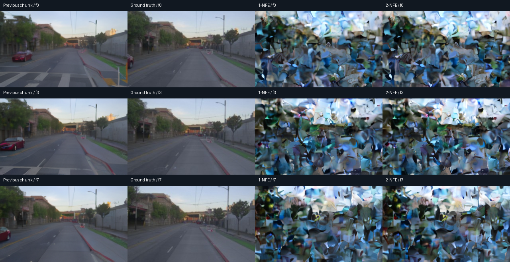
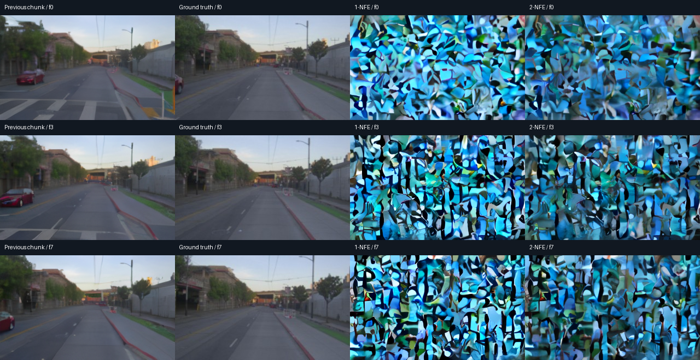
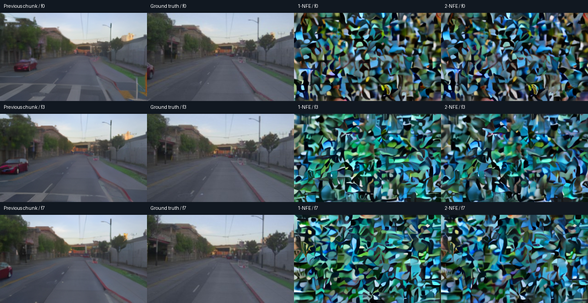
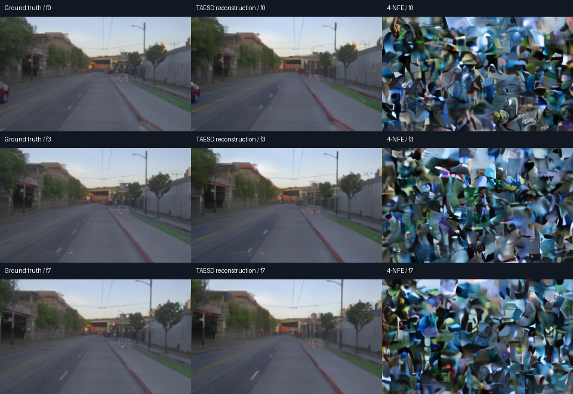

# PandaSet 5,000-step pilot: results and diagnosis

The pipeline completed, but the model failed the frozen quality gate. This is a
negative quality result, not a failed download or an accepted demo. No follow-up
training run or algorithm change is included in this report.

The evaluated implementation is commit `4430a661d8ea4a7ad988491de663b2e3f72f106f`.
Machine-readable aggregates and the entire evaluation curve are in
[metrics.json](metrics.json). No credentials, machine paths, cloud instance IDs,
weights or episode caches are included.

## Protocol and operational outcome

- PandaSet camera-only, pinned mirror revision
  `e2e123aea3b3132c67f4b395ec6120f63e190271` (unofficial public mirror).
- 60 training, 8 validation and 8 reserved test scenes, 80 frames per scene.
  Invalid whole scenes were excluded by metadata preflight before learning.
- 33 verified encoded caches reused; the remaining 43 scenes encoded remotely.
- Width-512, depth-12 DiT: 78,511,392 parameters. Independent planner: 3,280,036.
  Batch 16, peak LR 0.0003, 500-step warmup, EMA target 0.995.
- Stopped as planned at step 5,000 of the unchanged 20,000-step schedule.
  Validation used 40 windows across all 8 validation scenes, fixed seed 917,
  shared noise for 1/2/4 network evaluations (NFE). No new final-test evaluation.
- Target: native-front reconstruction with front-camera conditioning. This does
  not demonstrate future-only prediction, elevated views or safe vehicle control.
- Full archive: 44,520,528,731 bytes, SHA-256 verified; download plus verification
  80.16 minutes, approximately 9.26 MB/s effective average.
- Training including periodic evaluation: 52.35 minutes, approximately 1.59
  optimizer steps/second overall. Total workload: 144.15 minutes.
- RTX 3090 rental: approximately $0.62. Artifacts returned; instance destroyed.
  The full archive was temporary remote scratch and was not retained.

## Held-out result against the frozen gate

Pixel values are in [-1,1]; PSNR uses dynamic range 2. Metrics compare decoded
predictions against cached reference JPEGs, not against the lossy TAESD round trip.

| Metric | Initial | Step 500 | Step 5,000 | Frozen requirement at step 5,000 |
|---|---:|---:|---:|---|
| 1-NFE PSNR, dB | 8.5254 | 14.7472 | 10.0232 | >=15 and >=3 above initial: **fail** |
| 1-NFE pixel L1 | 0.61741 | 0.27528 | 0.50250 | >=25% reduction: **fail**, 18.61% |
| Waypoint XY L1, m | 9.3634 | 2.3929 | 2.4448 | Report separately; no safety threshold |

The preserved best 1-NFE checkpoint is step 500. Final PSNR improves only 1.50 dB
above initial and regresses 4.72 dB from that early checkpoint. More training did
not monotonically improve quality. Step 4,500 reached 18.00 dB at **4 NFE**, while
its 1-NFE result was 8.67 dB; this cannot substitute for the frozen one-step gate.
At step 5,000, 2-NFE and 4-NFE PSNR were 10.26 and 12.69 dB, respectively.

Visual review of steps 500, 2,500 and 5,000 shows texture-like artifacts without
useful road geometry. The single representative scene is a diagnostic example;
it does not by itself characterize all validation scenes. The 32-frame final
closed-loop rollout's chunk latent L1 values are 1.1543, 1.1452, 1.1414 and 1.1443.
These values establish neither good reconstruction nor zero drift.

## Diagnosis: evidence and uncertainty

**Established:** data preparation, CUDA preflight, backward/optimizer execution,
checkpointing and retrieval completed. TAESD round-trip images retain recognizable
road geometry in the saved example, while generated latents decode to artifacts.
A completely broken decoder or unreadable source is therefore less consistent
with that example, but a full quantitative decoder audit is still needed.

**Leading hypothesis:** the Mean-Flow generator's learned field becomes unstable
or inconsistent across time intervals. Evidence is early 1-NFE improvement followed
by regression, large differences between NFE variants and occasional loss spikes.
Across 5,000 logged steps, weighted flow loss has median 10.42 and maximum 4,902.88;
maximum pre-clipping gradient norm is 223.27 (training clips at 1). These are
signals to investigate, not proof of divergence or a specific implementation bug.

**Unresolved competing explanations:** learning rate/optimization instability,
inaccurate mixed-precision directional derivatives, training/sampling time-interval
coverage, or failure to use camera/previous-frame conditioning. The inspected loss
and sampler both use the data-to-noise convention and sampling subtracts the
predicted field; no sign error has been demonstrated. There is insufficient
evidence to blame dataset size, prescribe more steps, or declare overfitting.

**Confirmed observability gap:** `meanflow_loss` returns raw `flow_mse` and an
interior-sample count, but `train_cached_meanflow.py` discards them. It does not
record derivative norms, boundary versus interior error, or prediction/target
latent distributions. Therefore this run cannot identify the causal mechanism.

## Changes I would make, in order

1. **Add diagnostics before changing the objective.** Log raw and weighted losses,
   boundary/interior errors, derivative/target/prediction norms, latent moments,
   clipping frequency, precision and actual JVP backend. Save fixed training and
   validation examples with identical noise, plus raw/EMA comparisons. Add
   numerical TAESD round-trip metrics and previous-chunk-copy baselines. Keep the
   existing validation protocol and gate; extra metrics are diagnostic only.
2. **Check mathematical and numerical consistency cheaply.** Verify the sampler
   against an analytic constant-velocity oracle. At matched inputs/weights compare
   full-FP32 exact JVP, finite differences over several epsilons, and the current
   mixed-precision path; disable TF32 for the FP32 reference. Include inputs near
   t=0/1 and r=t, while keeping finite-difference probes within the time domain.
   Measure errors rather than assume mixed precision is the cause.
3. **Prove a tiny generator can fit real examples.** Use 1-2 training scenes and
   fixed windows, with training-only reconstruction/overfit checks. Compare the
   current loss to a boundary-only flow-matching control at identical inputs and
   compute budget. This is a diagnostic ablation, not a replacement benchmark.
   If both fail, inspect latent layout/scaling, patch ordering and conditioning
   before scaling up. If only Mean-Flow fails, isolate the derivative/target path.
4. **Then test stability changes one at a time.** If diagnostics support optimizer
   instability, compare LR 1e-4 against 3e-4 at the same seed, batch, objective and
   frozen validation windows. If precision error is material, compute the derivative
   target in FP32. Do not change LR, time sampling and precision simultaneously.
   Reserve multiple early checkpoints because the best point occurred at step 500.
5. **Require evidence before extending.** Record each short ablation's hypothesis,
   budget and stopping rule first. Retain the original 5,000-step outcome as failed;
   label any new objective or time distribution as a new experiment. Resume a full
   pilot only after the small checks discriminate a cause. Keep final test scenes
   reserved and defer style adapters and the public demo GIF until quality passes.

The first deliverable would be instrumentation and a small diagnostic experiment,
not a blind continuation to 20,000 steps. No new GPU lease was started for this report.

## Reviewer check and limits

A separate review pass checked that the report retains the original gate, reports
the best and final points, and does not substitute 4-NFE scores for one-step quality.
The 33 recovered caches changed preparation cost, not the frozen scene allocation
or quality criteria. The observed regression is real in the saved fixed-noise
validation curve, but one seed, one learning rate and one model do not establish a
root cause. Planner scores come from an independent head and are not evidence of
useful video generation. These are validation results, not a final test claim.

## Failure diagnostics, not demonstration media

The images below contain real PandaSet references and failed predictions. They are
included to make the negative result inspectable; no successful demo is claimed.

Best 1-NFE checkpoint, step 500:

Step 2,500:

Final step 5,000:

TAESD round trip and 4-NFE prediction at step 5,000:

