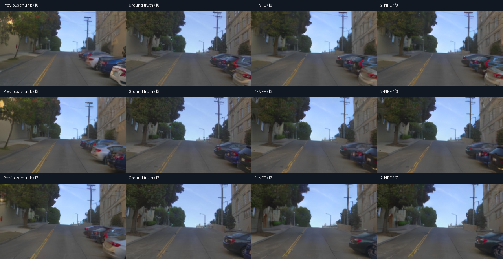
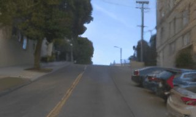

# Stage 1A: corrected Mean-Flow overfit check

**The one-window overfit gate passed.** The corrected base produced recognizable
roads, buildings and cars, without the earlier texture-like predictions. This is
a memorization/implementation check, not successful held-out full-base training or
a public product demo. It authorizes the requested one-scene dynamic-teacher
experiment after review, not the full pilot or 76-scene batch automatically.

Code: `d7219904a422db56d1d2cce626541ed73d82dae3`; managed detached transport is
published with `9971f7f`. The same training window (scene 040, start frame 8) was
repeated to batch 16; each control trained for 500 steps. A separate single window
from scene 056 retained its validation role. The full frozen 60/8/8 allocation and
reserved test scenes were not used to claim full-pilot quality here.

| Final diagnostic | Corrected Mean-Flow | Boundary-only control |
|---|---:|---:|
| Overfit 1-NFE PSNR | **30.755 dB** | See machine-readable report |
| Graded NFE | 1 | 4 |
| Graded overfit PSNR | **30.755 dB** | **31.128 dB** |
| TAESD round-trip reference | 31.052 dB | 31.052 dB |
| Mean-Flow derivative RMS median / max | **0.344 / 3.662** | JVP skipped |
| Numeric gate | Pass | Pass |

[Gate and full curves](gate.json), [metrics and codec/copy baselines](metrics.json),
[hash-bound visual review](visual_review.json).
The user-reviewed gate policy was recorded before these results were inspected:
0.5 dB step/peak tolerance, corrected Mean-Flow at 1 NFE, boundary control at 4 NFE,
and derivative median in (0,3], maximum <=10. The final Mean-Flow overfit score
fell just 0.036 dB from its peak, close to the codec reference. Weighted losses
remained within the configured bound. Boundary-only four-step conditioning still
uses intervals unseen during its training; this score is a control diagnostic.

## Limits and next decision

The corrected Mean-Flow's separate validation-window 1-NFE PSNR was **18.796 dB**,
below previous-chunk copy at **19.595 dB**. Later closed-loop frames become blurry.
Policy training was disabled; its random/frozen planner scores are not an improved
planner result. These results do not pass a held-out full-pilot quality gate.

Multiple stabilization changes were tested together, so this run does not uniquely
identify which change caused the improvement. It establishes that this corrected
implementation can fit one real window. More scenes, motion variety and independent
held-out evaluation are still needed. No 3DGS or style quality is established here.

The managed job succeeded: 266 seconds provisioning, 192 seconds setup and
452 seconds workload (both controls), approximately **$0.07** rental cost. Final
and best safe checkpoints and diagnostics were retrieved; the instance was
reported destroyed. Successful completion demonstrates the new managed execution
path, not resilience against every possible future network/host failure.

The next authorized experiment is the isolated **one-scene** dynamic 3DGS visual
check in the [roadmap](../../PIPELINE_ROADMAP.md). Full-pilot, batch rendering and
style training remain separate gated commands.

## Diagnostic visuals

Single-window fit (previous / reference / 1-NFE / 2-NFE):

Closed-loop diagnostic: later frames blur; this is not a finished demonstration.

