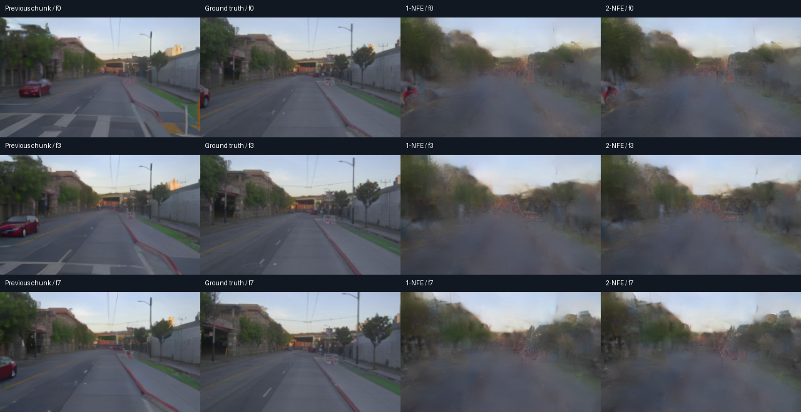
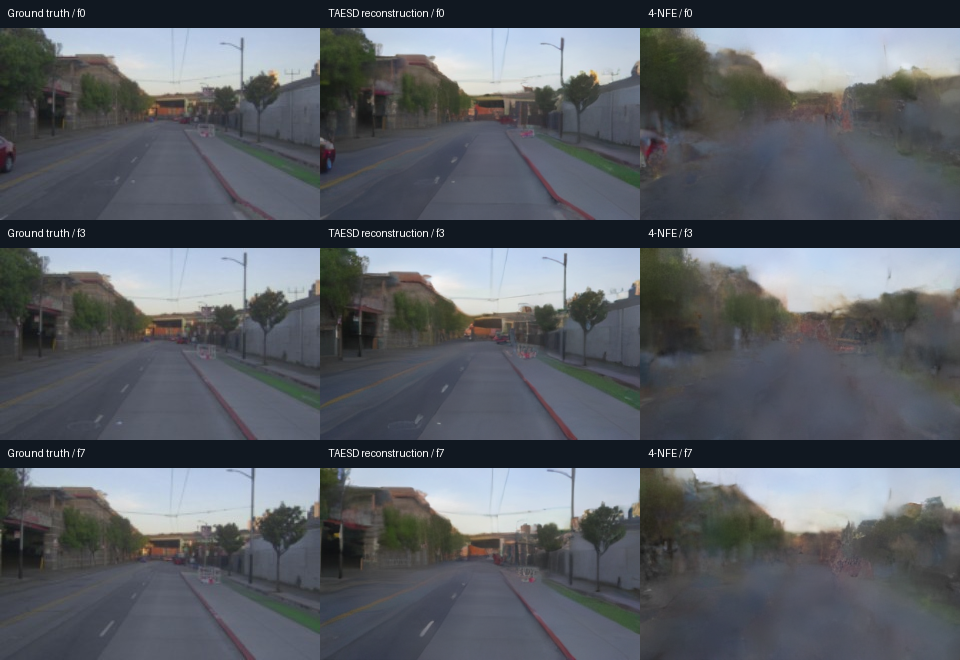
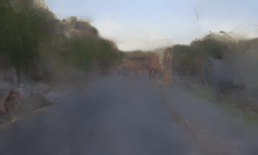

# Stage 1B: corrected Mean-Flow 5,000-step PandaSet pilot

**The frozen numerical gate passed; visual quality is insufficient for a finished
UnrealityView demo.** Roads and broad scene structure are recognizable, but fine
details remain blurred and ghosted. No full-dataset 3DGS or style training was
launched on the strength of this result.

Source commit: `5ae51f1e4ed3ff5f024276bf78806e754da7f322`.
Configuration: [model/training](../../../configs/pandaset_pilot_v2.json),
[frozen scene allocation](../../../configs/pandaset_validated_pilot.json).
The width-512/depth-12 DiT trained 5,000 steps, batch 16, on 60 scenes with
80 frames each, retaining the original 20,000-step learning-rate schedule.
Validation uses 40 windows across eight held-out scenes, fixed seed 917.
Eight test scenes remain reserved. No archive download was needed: all 76
verified encoded caches were reused.

## Numerical results

| Measurement | Result |
|---|---:|
| Initial validation 1-NFE PSNR | 8.525 dB |
| Final validation 1-NFE PSNR | **21.809 dB** |
| Improvement from initialization | **13.284 dB** |
| Previous-chunk copy PSNR | 18.751 dB |
| Improvement over copy | **3.058 dB** |
| Pixel L1, initial → final | 0.61741 → **0.10188** |
| Pixel L1 reduction | **83.50%** |
| TAESD round-trip PSNR reference | 30.251 dB |
| Final 2-NFE / 4-NFE PSNR | 21.767 / 21.745 dB |
| Best validation 1-NFE checkpoint | **Step 3,000: 21.885 dB** |

The unchanged numerical criteria were final PSNR >=15 dB and >=3 dB above
initialization, pixel L1 reduction >=25%, and beating previous-chunk copy PSNR.
All passed. PSNR is averaged over windows; overlapping windows within scenes
are not independent replicates. Pixels are compared with cached reference JPEGs,
not codec reconstructions. The codec score is an empirical reference, not a
mathematical upper bound. The earlier original pilot ended at 10.023 dB; multiple
v2 changes were made together, so their individual causal effects are unisolated.

[Final metrics](metrics.json), [gate](gate.json), [full evaluation curve and
artifact hashes](analysis.json), [training summary](training_summary.json),
[rollout errors](rollout_metrics.json).

## Analysis and limits

1. **Broad geometry improved, fine detail remains weak.** The inspected validation
   scene shows recognizable road direction, trees and buildings. Lane markings,
   poles, vehicle shapes and building edges are smeared or missing, with ghosting.
   This is a qualitative review of the first validation scene, not certification
   of every scene or an object-level accuracy measurement.
2. **Codec compression does not explain all the blur.** Its reconstruction preserves
   substantially more detail and scores about 8.44 dB above the final model.
   Model training/conditioning is a plausible source of the remaining error;
   this run does not isolate the cause.
3. **More inference steps did not improve these metrics.** Two and four evaluations
   slightly underperform one. Additional inference compute is not a demonstrated
   remedy for the current blur.
4. **Validation plateaued.** PSNR rose from 20.086 at step 500 to 21.885 at step
   3,000, then slipped 0.076 dB by step 5,000. This is not sufficient evidence
   to diagnose overfitting, or to expect a blind extension to 20,000 steps to
   restore sharp detail. Keep the validation-selected best checkpoint.
5. **Rollout error accumulates.** Latent L1 rises from 0.4323 to 0.4677 across four
   generated chunks (about 8.2%). The inspected 32-frame sequence does not collapse
   into texture, but remains soft; zero drift is not established.

This is **native front-camera reconstruction with ongoing recorded six-camera
conditioning**, including the observed front view. Each rollout chunk uses generated
history, but receives recorded camera observations. It is not an unconditioned
future forecast, flying-camera result, or closed-loop vehicle-control benchmark.
Policy loss was zero and the planner was not trained; waypoint scores are not
planner quality evidence. Test scenes have not been evaluated.

## Recommended next work

Preserve the step-3,000 best checkpoint and exact-resume state. Investigate
conditioning use, temporal alignment and detail loss with a small controlled
diagnostic before paying for a long extension. Separate hypotheses and compare
against the current frozen validation benchmark rather than changing its thresholds.
A one-scene dynamic 3DGS experiment is a separate engineering/visual check; this
report does not grant a front-view visual pass for downstream batch automation.
Hold full-dataset 3DGS, style training and the public showcase GIF until visual
quality is satisfactory. No new paid job was launched for this report.

Training took **2,595 seconds (~43.3 minutes)**; the managed workload took
2,636 seconds. Outputs and restart/best checkpoints were retrieved locally and the
rental was reported destroyed. Dataset caches, learned weights, private runtime
identifiers and machine paths are excluded from this report and Git.

## Diagnostic visuals

These images are diagnostics, not a finished product demonstration.
The contact sheet shows previous chunk / reference / 1-NFE / 2-NFE:

Reference / codec reconstruction / 4-NFE highlights the remaining detail gap:

32-frame rollout with ongoing recorded camera conditioning:

The subsequent [inference-only Step 0 diagnosis](diagnosis/README.md) exactly
reproduced the best-checkpoint baseline and measured train/validation and
conditioning sensitivity. It proposes a controlled next test, not a verified fix.
