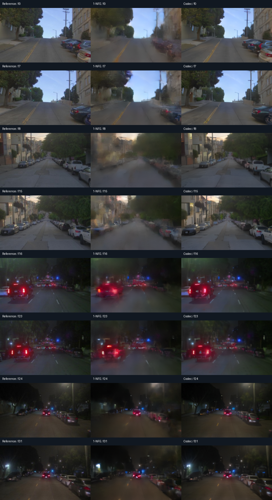
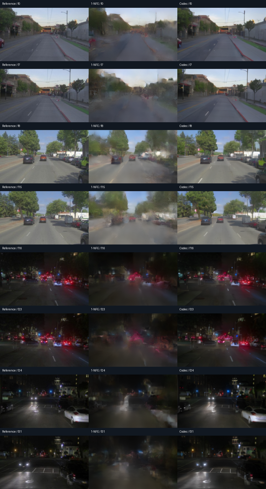

# Step 0: inference-only blur diagnosis

The saved step-3,000 checkpoint exactly reproduced the frozen validation baseline
(21.884630 dB; identical 40-window order and seed 917). No model training, cache
re-encoding, timing change or test-scene evaluation occurred. The managed job
succeeded, returned only JSON/inspection sheets, and its rental was destroyed.

| 1-NFE comparison | PSNR | Pixel L1 |
|---|---:|---:|
| Train: first window from 40 distinct scenes | 26.339 dB | 0.06520 |
| Validation: original 40 windows over 8 scenes | 21.885 dB | 0.10072 |
| Validation, wrong-scene camera features | 20.642 dB | See JSON |
| Validation, first-stage features frozen and aged | 21.880 dB | See JSON |
| Validation, zero previous chunk | 14.290 dB | See JSON |
| Validation, wrong-scene previous chunk | 13.987 dB | See JSON |

There is a measured 4.455 dB train/validation reconstruction gap. Train PSNR by
frame is roughly flat (26.02–26.61 dB); validation drops from 23.42 at f0 to 21.01
at f7. These observations support further generalization and temporal-conditioning
investigation. Training and validation motion/window distributions differ, so
this is not an isolated proof of overfitting.

Wrong-scene camera features reduce PSNR by 1.243 dB: camera conditioning matters.
Freezing later-stage camera updates changes average PSNR by only -0.0048 dB in
this control. History removal/substitution causes much larger degradation, though
these are out-of-distribution interventions. They measure sensitivity, not unique
causation or evidence that the model can succeed without history.

## Decision and critic review

No blur fix has been demonstrated. A finer spatial-token grid is a reasonable
next single-variable experiment; leave the split, timing, MeanFlow objective,
model width/depth, seed and benchmark fixed. First ensure grid-aware rays/cache
contracts and measure GPU memory/throughput before a matched training run.
Do not simultaneously add augmentation, CFG, sharpness losses or timing changes.
No Step 1 training has been launched.

Competing explanations remain: compressed semantic features, temporal information
not being exploited, limited training diversity and different motion difficulty.
A weak stage-freezing effect could also reflect correlated camera features. The
40 validation windows share eight scenes, and the train sample is 40 scenes at
one time position: do not treat windows as independent scene-level replicates or
claim statistical significance. A follow-up should also compare matched train
windows at corresponding temporal positions. The 32-frame rollout is not part of
this test, and neither planning nor flying-view quality is established here.

[Machine-readable metrics, frame profiles, sample identities and caveats](diagnosis.json).
[Protocol](../../../BLUR_DIAGNOSIS.md).

Four training scenes, first/final frames (reference / 1-NFE / codec):

Four validation scenes, first/final frames:

