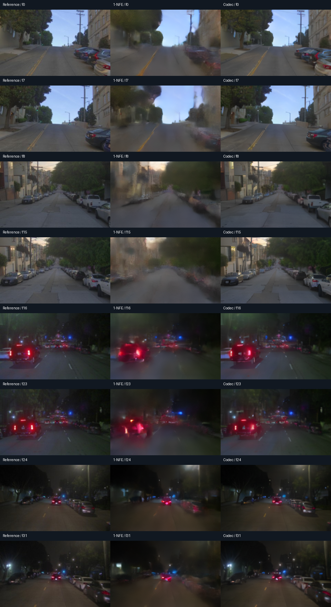
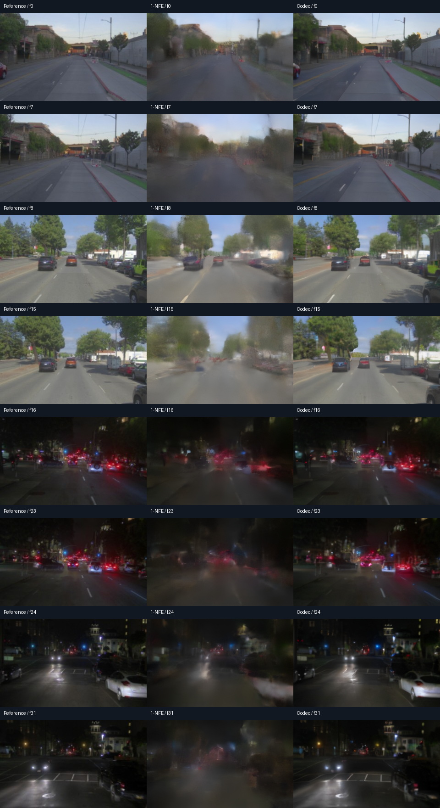
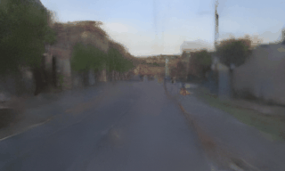

# Prompt A: PandaSet v3 Arm E, 5,000 steps

**Execution succeeded, but Arm E did not improve held-out reconstruction quality.**
The pilot completed all 5,000 steps, returned the best checkpoint/full resume state,
and completed the matched train/validation diagnosis. The validation-best checkpoint
was step 2,500, not the final step. Its PSNR was 21.5860 dB; diagnosis reproduced it
at 21.5858 dB, within the frozen 0.05 dB tolerance. Final-step PSNR was 21.4295 dB.

Source: `f367a602887c24e4244e3ec04c216643d24e2693`. [Protocol](../../ARM_E_PROTOCOL.md),
[comparison/attention health](comparison.json), [execution and visual review](execution.json),
[all evaluation points](evaluation_curve.json), [training configuration](run_config.json),
[training summary](training_summary.json).

## Head-to-head against v2 best

| Diagnostic | v2 | Arm E best |
|---|---:|---:|
| Validation 1-NFE PSNR | 21.8846dB | **21.5858dB** |
| Validation pixel L1 | 0.10072 | **0.11083** |
| Validation latent L1 | 0.41667 | **0.40997** |
| Matched train 1-NFE PSNR | 26.3392dB | **25.0941dB** |
| Train-minus-validation gap | 4.4546dB | **3.5083dB** |
| Validation f7-minus-f0 PSNR | -2.4189dB | **-3.6854dB** |
| Frozen-stage PSNR delta | -0.0048dB | **-0.1275dB** |
| Wrong-scene UVE PSNR delta | -1.2430dB | **-4.6372dB** |
| Zero previous-history PSNR | 14.2898dB | **18.1532dB** |
| Wrong-scene previous-history PSNR | 13.9868dB | **16.4306dB** |

Arm E's best 2/4-NFE PSNR was 21.1665/21.2049 dB in the matched diagnosis; more
inference steps did not improve the result. The modest latent-L1 improvement does
not override worse pixel L1, PSNR and temporal decay. The smaller train/validation
gap partly reflects worse training reconstruction, not proof of improved quality.
The original coarse numeric front gate still passes; the stricter Arm E targets
and visual-quality criteria do not.

## What changed and what the controls establish

The original 4x8 cache stayed unchanged. The bundle added cross-only learnable QK
scaling, 3D query-position initialization, LayerNorm/Fourier-ray fusion and 25%
previous-history dropout. All legacy defaults remain off/zero. The existing 384
cached channels retain their historical fixed ray embedding; the learned fusion
adds another geometry path. There was no re-encoding, 10x16 experiment, CFG,
sharpness loss, style training, test upload/evaluation or 3DGS work in this job.

Camera-conditioning sensitivity increased: a wrong-scene substitution now hurts
much more, and zero-history reconstruction improved by 3.86 dB. Those controls are
out of distribution and do not identify a unique cause or prove sufficient use of
fresh observations. The bundle changes multiple variables; individual contributions
are not isolated. It produced a useful diagnostic result, not a successful blur fix.

| Stage | Normalized attention entropy | Mean effective QK scale |
|---|---:|---:|
| 0 | 0.4831 | 1.9989 |
| 1 | 0.5181 | 2.0112 |
| 2 | 0.5337 | 2.0973 |
| 3 | 0.5582 | 2.0662 |

Entropy is averaged over queries/heads in baseline validation 1-NFE inference,
normalized by log(valid key count). Effective scale is exp(logit_scale), capped 8;
all per-stage min/mean/max values and raw log-parameter means are in the JSON.
No baseline entropy measurement exists, so this is not a measured pre/post
attention-collapse comparison.

Frozen conditioning targets: wrong-scene UVE sensitivity and entropy passed.
Zero-history 18.15 dB missed 19.5; frozen-stage -0.1275 dB missed -0.15; stage 0 mean
scale 1.9989 missed the requirement that every stage mean exceed 2. Quality PSNR
and frame-decay targets failed. No thresholds were relaxed after seeing results.

## Visual review and decision

The inspected four-scene validation sheet still shows smeared vehicle shapes,
weak poles/lane detail and ghosting. Later frames are softer; the 32-frame rollout
retains broad road layout but does not demonstrate crisp reconstruction or zero
drift. Treat it as a diagnostic, not a public product showcase. The planner was
untrained (policy weight 0); waypoint metrics are not planning-quality evidence.

Keep v2 as the stronger PSNR baseline. Do not extend Arm E blindly or claim the
blur issue solved. Before another paid generator experiment, inspect temporal
stage use and consider component ablations or a controlled appearance-feature
study. Those would need a separately frozen design; no further generator run has
been started. Per the user's instruction, Prompt B was launched independently.

## Artifacts and cost

Training/diagnosis workload: **41.72 minutes**.
Provisioning 201.0 seconds, setup 125.0 seconds.
Approximate rental charge **$0.236**, below the $1 cap. The rental was destroyed.
Only compact outputs returned(~1.63 GB, primarily exact-resume/best weights);
no dataset return and no weights in Git. This was the sole paid Prompt A attempt.

[Best metrics](best_metrics.json), [diagnosis](diagnosis/diagnosis.json),
[rollout errors](best_rollout_metrics.json).

Four train scenes (reference / 1-NFE / codec):

Four validation scenes:

Camera-conditioned 32-frame rollout; recorded camera observations remain available:

